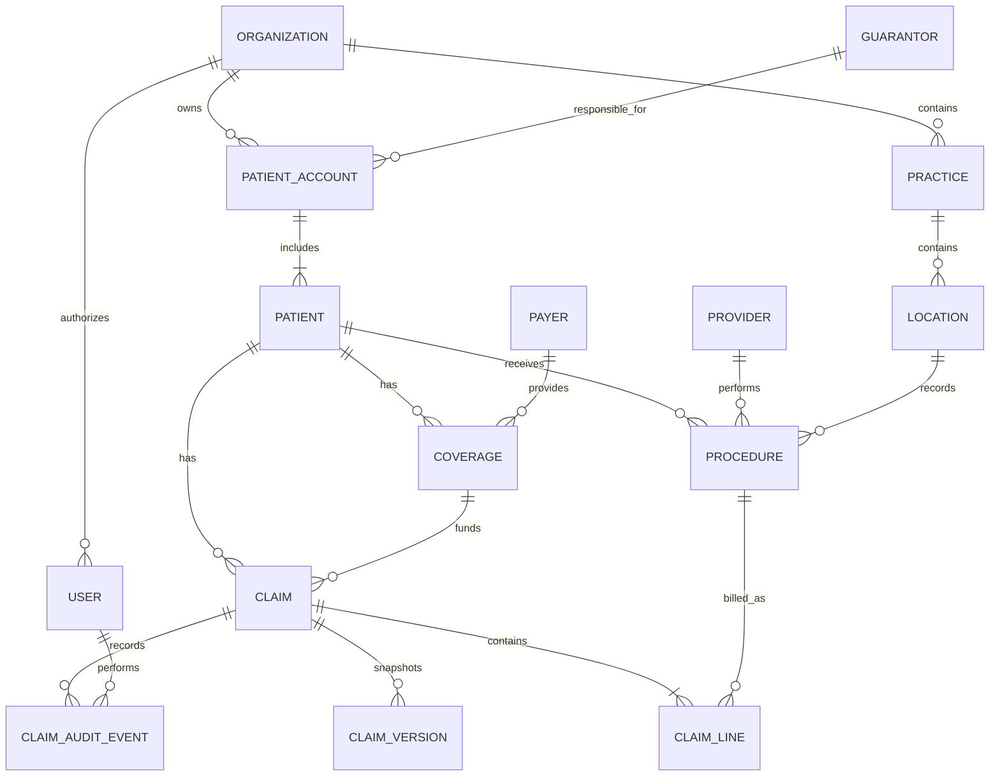

# Claims & Ledger V1 — Claim Preparation Product and Technical Specification

## Stage Boundary

Claim preparation begins when an insured procedure is marked `COMPLETED` in PbN. It ends when a billing coordinator approves a valid claim and PbN produces an immutable claim version in `READY` state. Sending the claim to a clearinghouse begins the Submission stage and is outside this specification.

## Workflow Contract

| Element | Claim-preparation behavior |
|---|---|
| Actor | The clinical provider completes the procedure. PbN assembles and validates the draft. The billing coordinator corrects source data and approves the claim. |
| Trigger | `procedures.status` changes to `COMPLETED` for a procedure with active primary coverage. |
| Inputs | PbN reads the patient, account, coverage, payer, practice, location, provider, procedure, and authenticated user records defined in the data model. |
| Action | PbN creates the claim and claim line once, displays every required value, validates the draft, and saves corrections to the applicable source record. |
| Decision | A draft with any blocking validation error remains `DRAFT`. A valid draft can be approved by a `BILLING_COORDINATOR` or `ORG_ADMIN`. |
| Output | Approval changes the claim to `READY` and creates one immutable `claim_versions` row containing the approved values. |
| Failure path | A repeated completion event returns the existing draft. A stale edit is rejected for refresh. A repeated approval request returns the version created by the first request. No failure creates a partial or duplicate claim version. |

## Functional Specification

### Claim preparation

The billing coordinator can turn completed insured treatment into an accurate, submission-ready primary claim without re-entering information or billing the same procedure twice. A requirement may be drawn from the required product capabilities,<sup>10</sup> the selected scope, an industry standard, or a product-design decision.

| ID | PbN behavior | Acceptance condition | Source |
|---|---|---|---|
| FR-01 | When a dentist marks an insured procedure complete, PbN creates or updates a draft primary claim using the patient and subscriber relationship, insurance plan, treating and billing providers, service date, location, CDT procedure, tooth or surface when applicable, fee, and supporting information already recorded in PbN. | Every eligible completed procedure is linked to exactly one claim line, and the copied information matches its source record. Reprocessing the same procedure returns the existing claim and creates nothing new. | <sup>6,10</sup> |
| FR-02 | PbN validates the draft before submission, identifies each missing or invalid field, and allows the billing coordinator to correct the claim and rerun validation. | PbN identifies every blocking error and cannot mark the claim ready to submit until those errors are resolved. | <sup>6,10</sup> |
| FR-03 | When the billing coordinator approves a valid draft, PbN changes the claim from `DRAFT` to `READY` and creates an immutable `claim_versions` row containing the exact approved claim data. | Editing a `DRAFT` claim creates no version. Approval creates exactly one version containing the approved values. If an approved claim is edited and approved again, PbN creates the next version and leaves every earlier version unchanged. | Product-design decision |

## UX Contract

| Element | Value shown or captured | Data source | Behavior |
|---|---|---|---|
| Patient | Name, birth date, and address | `patients` | Displays current PbN data; **Edit patient** updates the patient record and reruns validation. |
| Coverage | Payer, subscriber ID, coverage order, relationship, and effective dates | `coverages`, `payers` | Allows selection among the patient's active coverages. |
| Billing provider | Legal name, billing NPI, and tax ID | `practices` | Displays the billing entity derived from the service location. |
| Treating provider | Name and NPI | `providers` | Displays the provider recorded on the completed procedure. |
| Service location | Name and address | `locations` | Displays the location recorded on the completed procedure. |
| Procedure line | Service date, CDT code, tooth, surfaces, and fee | `procedures` | **Edit procedure** updates the source procedure and reruns validation. |
| Validation summary | Field, error, and corrective action | Claim validation rules | Groups every blocking error and links to the source field that must be corrected. |
| Approve claim | Approval confirmation | Authenticated `users` record | Enabled only when validation passes; changes the claim to `READY` and returns the approved version. |

## System Boundary and Data Flow

The Claims component owns `claims`, `claim_lines`, `claim_versions`, and `claim_audit_events`. Patient, account, coverage, payer, practice, location, provider, and procedure records remain the source of truth in their PbN PMS components. Draft creation consumes a durable `ProcedureCompleted` event. Review, correction, validation, and approval use synchronous APIs so the billing coordinator receives the current result immediately. Claim approval and version creation commit in one database transaction.

## ER Diagram



## Database Schema

This appendix uses PostgreSQL-style logical types. Identifiers comply with IETF UUID RFC 9562,<sup>1</sup> monetary values use `numeric(12,2)`, and timestamps use UTC `timestamptz`. Content hashes are lowercase, 64-character SHA-256 digests of canonical source content.<sup>5</sup> Short identifiers such as `org-001` are readable aliases for UUID values. Every Example column belongs to the same fictional but realistic record set, and every foreign key includes `organization_id` so a record cannot reference another tenant.

### Claim preparation

Only the PbN PMS columns consumed by this workflow are shown below. These are the persisted inputs from which a claim is assembled.

#### `organizations`

This table defines the PbN customer and tenant boundary so all billing entities, locations, users, patients, and financial records remain isolated from other customers.

| Column | Type | Key or constraint | Example |
|---|---|---|---|
| `organization_id` | `uuid` | PK | `org-001` |
| `name` | `varchar(150)` | Required | `River Dental Group` |

#### `practices`

This table represents the legal billing entity whose tax ID and billing NPI appear on claims; it is separate because one organization may own multiple billing entities and each billing entity may operate multiple locations.

| Column | Type | Key or constraint | Example |
|---|---|---|---|
| `organization_id` | `uuid` | PK; FK → `organizations` | `org-001` |
| `practice_id` | `uuid` | PK | `practice-001` |
| `legal_name` | `varchar(150)` | Required | `River Dental Associates` |
| `billing_npi` | `char(10)` | Required 10-digit NPI; validate against NPPES<sup>7–8</sup> | `1234567893` |
| `tax_id` | `varchar(20)` | Required; encrypted | `12-3456789` |

#### `locations`

This table identifies the physical office where treatment occurred; it is separate from the billing entity because multiple offices may submit claims under the same tax ID and billing NPI.

| Column | Type | Key or constraint | Example |
|---|---|---|---|
| `organization_id` | `uuid` | PK; FK → `organizations` | `org-001` |
| `location_id` | `uuid` | PK | `location-001` |
| `practice_id` | `uuid` | FK → `practices` | `practice-001` |
| `name` | `varchar(150)` | Required | `Downtown Austin office` |
| `address_line_1` | `varchar(150)` | Required | `100 Main Street` |
| `city` | `varchar(80)` | Required | `Austin` |
| `state_code` | `char(2)` | Required U.S. postal abbreviation | `TX` |
| `postal_code` | `varchar(10)` | Required | `78701` |

#### `users`

This table identifies staff members and their roles so approvals, manual corrections, and access can be attributed to a specific authorized person.

| Column | Type | Key or constraint | Example |
|---|---|---|---|
| `organization_id` | `uuid` | PK; FK → `organizations` | `org-001` |
| `user_id` | `uuid` | PK | `user-007` |
| `display_name` | `varchar(150)` | Required | `Ana Patel` |
| `role` | `varchar(30)` | `ORG_ADMIN`, `BILLING_COORDINATOR`, `FINANCE_REVIEWER`, `CLINICAL_PROVIDER`, or `READ_ONLY` | `BILLING_COORDINATOR` |

#### `patient_accounts`

This table is the financial container that holds charges, payments, credits, and balances; multiple patients, such as members of one family, may share one account.<sup>9</sup>

| Column | Type | Key or constraint | Example |
|---|---|---|---|
| `organization_id` | `uuid` | PK; FK → `organizations` | `org-001` |
| `account_id` | `uuid` | PK | `account-001` |
| `guarantor_id` | `uuid` | FK → `guarantors` | `guarantor-001` |

#### `guarantors`

This table identifies the person legally responsible for paying the account balance; it is separate from the patient because the legally responsible person may not have received treatment.<sup>9</sup>

| Column | Type | Key or constraint | Example |
|---|---|---|---|
| `organization_id` | `uuid` | PK; FK → `organizations` | `org-001` |
| `guarantor_id` | `uuid` | PK | `guarantor-001` |
| `first_name` | `varchar(80)` | Required | `Maya` |
| `last_name` | `varchar(80)` | Required | `Chen` |
| `address_line_1` | `varchar(150)` | Required | `25 Lake Street` |
| `city` | `varchar(80)` | Required | `Austin` |
| `state_code` | `char(2)` | Required U.S. postal abbreviation | `TX` |
| `postal_code` | `varchar(10)` | Required | `78702` |

#### `patients`

This table identifies the person who receives treatment and whose insurance claim is submitted; it connects that person to a financial account, coverage, procedures, and claims.

| Column | Type | Key or constraint | Example |
|---|---|---|---|
| `organization_id` | `uuid` | PK; FK → `organizations` | `org-001` |
| `patient_id` | `uuid` | PK | `patient-001` |
| `account_id` | `uuid` | FK → `patient_accounts` | `account-001` |
| `first_name` | `varchar(80)` | Required | `Maya` |
| `last_name` | `varchar(80)` | Required | `Chen` |
| `date_of_birth` | `date` | Required | `1990-06-12` |
| `address_line_1` | `varchar(150)` | Required | `25 Lake Street` |
| `city` | `varchar(80)` | Required | `Austin` |
| `state_code` | `char(2)` | Required U.S. postal abbreviation | `TX` |
| `postal_code` | `varchar(10)` | Required | `78702` |

#### `payers`

This table stores each insurer's reusable identity and electronic routing value because many patient coverages and claims may use the same insurer.

| Column | Type | Key or constraint | Example |
|---|---|---|---|
| `organization_id` | `uuid` | PK; FK → `organizations` | `org-001` |
| `payer_id` | `uuid` | PK | `payer-a` |
| `name` | `varchar(150)` | Required | `Insurer A` |
| `electronic_payer_id` | `varchar(50)` | Required clearinghouse routing value | `A001` |

#### `coverages`

This table records a patient's specific insurance policy, subscriber identifier, coverage order, and effective dates; it is separate from the payer because each patient has a distinct policy relationship with the insurer.

| Column | Type | Key or constraint | Example |
|---|---|---|---|
| `organization_id` | `uuid` | PK; FK → `organizations` | `org-001` |
| `coverage_id` | `uuid` | PK | `coverage-001` |
| `patient_id` | `uuid` | FK → `patients` | `patient-001` |
| `payer_id` | `uuid` | FK → `payers` | `payer-a` |
| `subscriber_patient_id` | `uuid` | Nullable FK → `patients`; required when subscriber is a PbN patient | `patient-001` |
| `subscriber_id` | `varchar(80)` | Required identifier assigned to the policyholder by the insurer<sup>6</sup> | `A-882410` |
| `coverage_order` | `varchar(20)` | `PRIMARY`, `SECONDARY`, or `TERTIARY` | `PRIMARY` |
| `relationship_to_subscriber` | `varchar(20)` | `SELF`, `SPOUSE`, `CHILD`, or `OTHER` | `SELF` |
| `effective_from` | `date` | Required | `2026-01-01` |
| `effective_to` | `date` | Nullable | `null` |

#### `providers`

This table identifies the clinician who performed treatment and supplies the NPI required to identify that provider on the claim.

| Column | Type | Key or constraint | Example |
|---|---|---|---|
| `organization_id` | `uuid` | PK; FK → `organizations` | `org-001` |
| `provider_id` | `uuid` | PK | `provider-001` |
| `display_name` | `varchar(150)` | Required | `Dr. Elena Ruiz` |
| `npi` | `char(10)` | Required 10-digit NPI; validate against NPPES<sup>7–8</sup> | `1234567893` |

#### `procedures`

This table records the completed clinical service and fee that may be billed, giving claim preparation one source procedure to reference and protecting against billing the same procedure twice.

| Column | Type | Key or constraint | Example |
|---|---|---|---|
| `organization_id` | `uuid` | PK; FK → `organizations` | `org-001` |
| `procedure_id` | `uuid` | PK | `procedure-001` |
| `patient_id` | `uuid` | FK → `patients` | `patient-001` |
| `provider_id` | `uuid` | FK → `providers` | `provider-001` |
| `location_id` | `uuid` | FK → `locations` | `location-001` |
| `procedure_code` | `varchar(10)` | Required ADA CDT code valid on `service_date`; complete values in the licensed annual CDT set<sup>2–4</sup> | `D2391` |
| `service_date` | `date` | Required | `2026-09-13` |
| `fee` | `numeric(12,2)` | Non-negative | `200.00` |
| `tooth_number` | `varchar(4)` | Nullable ADA designation: `1`–`32` for permanent teeth or `A`–`T` for primary teeth<sup>6</sup> | `30` |
| `tooth_surfaces` | `varchar(10)` | Nullable ADA codes `B`, `D`, `F`, `I`, `L`, `M`, or `O`; concatenate multiple codes without spaces<sup>6</sup> | `O` |
| `status` | `varchar(20)` | `SCHEDULED`, `COMPLETED`, or `VOIDED` | `COMPLETED` |

#### Inputs mapped to destination columns

| Input column | Supplier | Destination column |
|---|---|---|
| Authenticated `organization_id` | PbN session context | `claims.organization_id`, `claim_lines.organization_id`, `claim_versions.organization_id` |
| `patients.patient_id` | PbN patient record | `claims.patient_id` |
| `patients.account_id` | PbN patient record | `claims.account_id` |
| `coverages.coverage_id` | PbN coverage selected for the claim | `claims.coverage_id` |
| `practices.practice_id` | PbN practice configuration | `claims.practice_id` |
| `procedures.location_id` | Completed procedure | `claims.location_id` |
| `procedures.procedure_id` | Completed procedure | `claim_lines.procedure_id` |
| `procedures.procedure_code` | Clinical staff using ADA CDT | `claim_lines.procedure_code` |
| `procedures.fee` | Practice fee schedule recorded with the procedure | `claim_lines.billed_amount` |
| Patient name, birth date, and address | PbN `patients` record | `claim_versions.claim_snapshot.patient` |
| Coverage subscriber ID, order, and subscriber relationship | PbN `coverages` record | `claim_versions.claim_snapshot.coverage` |
| Payer ID, name, and electronic payer ID | PbN `payers` record | `claim_versions.claim_snapshot.payer` |
| Practice legal name, billing NPI, and tax ID | PbN `practices` record | `claim_versions.claim_snapshot.billing_provider` |
| Treating-provider ID, name, and NPI | PbN `providers` record | `claim_versions.claim_snapshot.treating_provider` |
| Location ID, name, and address | PbN `locations` record | `claim_versions.claim_snapshot.service_location` |
| Procedure date, code, fee, tooth, and surfaces | PbN `procedures` record | `claim_versions.claim_snapshot.lines[]` |
| `users.user_id` | Billing coordinator approving the claim | `claim_versions.approved_by`, `claim_audit_events.actor_user_id` |
| Approval `Idempotency-Key` | PbN claim-review UI | `claim_versions.approval_idempotency_key`, `claim_audit_events.request_id` |

#### Values generated by PbN

| Generated value | Destination column | Generation rule |
|---|---|---|
| Claim identifier | `claims.claim_id` | Generate one UUID when the claim is created. |
| Claim number | `claims.claim_number` | Generate a human-readable identifier unique within the organization. |
| Initial claim state | `claims.processing_status` | Set to `READY` only after required-field validation and approval. |
| Claim-line identifier | `claim_lines.claim_line_id` | Generate one UUID per billed procedure. |
| Claim-line sequence | `claim_lines.line_number` | Assign `1..n` within the claim. |
| Claim-version identifier | `claim_versions.claim_version_id` | Generate one UUID for each approved version. |
| Version number | `claim_versions.version_number` | Start at `1`; increment for each corrected version. |
| Immutable approved snapshot | `claim_versions.claim_snapshot` | Copy the approved source values listed above; never update the snapshot in place. |
| Snapshot hash | `claim_versions.content_hash` | Calculate SHA-256 over the canonical snapshot. |
| Creation and approval times | `claims.created_at`, `claim_versions.approved_at` | Record PbN server time in UTC. |
| Audit-event identifier and facts | `claim_audit_events.audit_event_id`, `event_type`, `details`, `occurred_at` | Generate one append-only record for each state-changing action. |

#### Stage output

| Output record | Exact output at the end of claim preparation |
|---|---|
| `claims` | One row with `processing_status = READY`. |
| `claim_lines` | One or more rows. Maya's row contains `procedure_code = D2391` and `billed_amount = 200.00`. |
| `claim_versions` | One approved, immutable row containing the exact values approved when the claim became `READY`. |
| `claim_audit_events` | One `APPROVED` row linking the user, request, claim, and approved version. |
| Submission-stage input | `claim_versions.claim_version_id`; the submission stage uses this version to generate the X12 837D transaction. |

#### `claims`

This table represents the overall payment request sent to one insurer for one patient and coverage, and stores its current processing state.

| Column | Type | Key or constraint | Example |
|---|---|---|---|
| `organization_id` | `uuid` | PK; FK → `organizations` | `org-001` |
| `claim_id` | `uuid` | PK | `claim-001` |
| `patient_id` | `uuid` | FK → `patients` | `patient-001` |
| `account_id` | `uuid` | FK → `patient_accounts` | `account-001` |
| `coverage_id` | `uuid` | FK → `coverages` | `coverage-001` |
| `practice_id` | `uuid` | FK → `practices` | `practice-001` |
| `location_id` | `uuid` | FK → `locations` | `location-001` |
| `claim_number` | `varchar(50)` | Unique within organization | `PB-1001` |
| `processing_status` | `varchar(30)` | `DRAFT` or `READY` | `READY` |
| `row_version` | `bigint` | Optimistic concurrency value | `1` |
| `created_at` | `timestamptz` | Required | `2026-09-13T16:00:00Z` |
| `updated_at` | `timestamptz` | Required | `2026-09-13T16:10:00Z` |

#### `claim_lines`

This table itemizes the procedures and fees within a claim because insurers adjudicate and adjust individual services, not only the claim total.

| Column | Type | Key or constraint | Example |
|---|---|---|---|
| `organization_id` | `uuid` | PK; FK → `organizations` | `org-001` |
| `claim_line_id` | `uuid` | PK | `claim-line-001` |
| `claim_id` | `uuid` | FK → `claims` | `claim-001` |
| `procedure_id` | `uuid` | FK → `procedures`; one active claim line per procedure | `procedure-001` |
| `line_number` | `smallint` | Unique within claim | `1` |
| `procedure_code` | `varchar(10)` | Required ADA CDT code copied from `procedures`; preserve the code valid on the service date<sup>2–4</sup> | `D2391` |
| `billed_amount` | `numeric(12,2)` | Non-negative | `200.00` |

#### `claim_versions`

This table preserves each approved claim without changing an earlier version. PbN creates a `claim_versions` row when the billing coordinator approves a valid draft and the claim moves to `READY`. Edits while the claim remains `DRAFT` create no versions. If an approved claim is changed and approved again, PbN creates the next version instead of modifying the earlier one.

| Column | Type | Key or constraint | Example |
|---|---|---|---|
| `organization_id` | `uuid` | PK; FK → `organizations` | `org-001` |
| `claim_version_id` | `uuid` | PK | `claim-version-001` |
| `claim_id` | `uuid` | FK → `claims` | `claim-001` |
| `version_number` | `integer` | Unique within claim | `1` |
| `claim_snapshot` | `jsonb` | Immutable after approval | `{"patient":{"id":"patient-001","name":"Maya Chen","date_of_birth":"1990-06-12","address":"25 Lake Street, Austin, TX 78702"},"coverage":{"id":"coverage-001","subscriber_id":"A-882410","order":"PRIMARY","relationship":"SELF"},"payer":{"id":"payer-a","name":"Insurer A","electronic_payer_id":"A001"},"billing_provider":{"practice_id":"practice-001","name":"River Dental Associates","npi":"1234567893","tax_id":"12-3456789"},"treating_provider":{"id":"provider-001","name":"Dr. Elena Ruiz","npi":"1234567893"},"service_location":{"id":"location-001","name":"Downtown Austin office","address":"100 Main Street, Austin, TX 78701"},"lines":[{"procedure_id":"procedure-001","service_date":"2026-09-13","code":"D2391","tooth":"30","surfaces":"O","amount":200.00}]}` |
| `content_hash` | `varchar(64)` | Immutable SHA-256 hash of canonical `claim_snapshot`<sup>5</sup> | `8b1a...e92c` |
| `approval_idempotency_key` | `varchar(100)` | Required; unique within claim | `approve-req-9f42` |
| `approved_by` | `uuid` | FK → `users` | `user-007` |
| `approved_at` | `timestamptz` | Required | `2026-09-13T16:10:00Z` |

#### `claim_audit_events`

This append-only table explains who or what created, changed, validated, or approved a claim. It is separate from `claims` because the claim row stores only current state, while the audit table preserves the sequence of changes.

| Column | Type | Key or constraint | Example |
|---|---|---|---|
| `organization_id` | `uuid` | PK; FK → `organizations` | `org-001` |
| `audit_event_id` | `uuid` | PK | `audit-001` |
| `claim_id` | `uuid` | FK → `claims` | `claim-001` |
| `actor_user_id` | `uuid` | Nullable FK → `users`; null for a system action | `user-007` |
| `event_type` | `varchar(30)` | `DRAFT_CREATED`, `SOURCE_CORRECTED`, `VALIDATION_FAILED`, `APPROVED`, or `RETURNED_TO_DRAFT` | `APPROVED` |
| `request_id` | `varchar(100)` | Required correlation identifier | `approve-req-9f42` |
| `details` | `jsonb` | Required event facts; must not contain secret credentials | `{"claim_version_id":"claim-version-001","version_number":1}` |
| `occurred_at` | `timestamptz` | Required; PbN server time in UTC | `2026-09-13T16:10:00Z` |

## Tenant Isolation and Access Control

### Tenancy model

The above is a shared-database, shared-schema model. Claims for all customer organizations are stored in one physical `claims` table; no separate copy of the table is created for each organization. Every tenant-owned row contains `organization_id`, which is included in its primary and foreign keys. Application IAM identifies the user's organization, and PostgreSQL row-level security prevents access to every other organization's rows.

A tenant is one customer organization. River Dental and Lake Dental may share the same application and database infrastructure, but each is treated as a separate tenant. The tenant boundary is represented by an `organizations` row. A small practice may be represented by one organization and one location; a dental group may be represented by one organization containing several practices and locations.

Tenant-owned data is a record that belongs to exactly one organization, so `organization_id` is included in each record.

For example, a patient is identified in `patients` by the composite primary key `(organization_id, patient_id)`, while a claim is identified in `claims` by `(organization_id, claim_id)`. A claim also stores `(organization_id, patient_id)` as a composite foreign key to `patients`. This foreign key verifies that the claim and patient belong to the same organization.

Assume `patient-900` belongs to Lake Dental as `(org-002, patient-900)`. If a River Dental claim tries to reference that patient as `(org-001, patient-900)`, the database looks for the exact patient pair `(org-001, patient-900)`. That pair does not exist, so the claim is rejected. `(organization_id, patient_id)` is not used as the claim's primary key because one patient can have multiple claims; each claim therefore needs its own `claim_id`.

### Tenant isolation

Tenant isolation prevents one organization from reading, creating, changing, deleting, or referencing another organization's data.

**Application-level access control.** IAM verifies that the user is registered and identifies the organizations to which the user belongs. When an organization is selected, the backend confirms that membership and derives the trusted `organization_id` from the authenticated session. The browser cannot set an unauthorized organization. The derived value becomes the database transaction's tenant context.

**Core rule.** Every tenant-owned row has an `organization_id`, and every database transaction has one trusted `organization_id` in its context. Row-level security allows the transaction to see or change only rows whose value matches that context.<sup>11</sup>

For example, when Ana works in River Dental, the transaction context is set to River Dental's organization ID. `SELECT`, `UPDATE`, and `DELETE` can see only River Dental's rows. `INSERT` can create only River Dental rows. Lake Dental's rows remain invisible and cannot be changed.

**Row-level security policy**

```sql
ALTER TABLE claims ENABLE ROW LEVEL SECURITY;
ALTER TABLE claims FORCE ROW LEVEL SECURITY;

CREATE POLICY claims_by_organization ON claims
USING (
    organization_id = current_setting('app.organization_id', true)::uuid
)
WITH CHECK (
    organization_id = current_setting('app.organization_id', true)::uuid
);
```

`USING` restricts which rows can be selected, updated, or deleted. `WITH CHECK` restricts which rows can be inserted or updated.

**Transaction example**

```sql
BEGIN;

-- River Dental's actual organization UUID
SET LOCAL app.organization_id =
    '11111111-1111-1111-1111-111111111111';

SELECT * FROM claims;
-- Returns only River Dental claims.

INSERT INTO claims (organization_id, claim_id)
VALUES (
    '22222222-2222-2222-2222-222222222222',
    '33333333-3333-3333-3333-333333333333'
);
-- Rejected because the inserted organization does not match the context.

COMMIT;
```

The organization ID is derived from the authenticated session and set by the backend; it is not simply accepted from the browser or REST API clients. `SET LOCAL` keeps the context within one transaction, so a pooled connection cannot carry River Dental's context into a later Lake Dental request. Composite foreign keys provide an additional check by preventing a River Dental record from referencing a Lake Dental record.

**Limitations**

- Row-level security depends on the backend setting the correct organization context.
- Permissions among users within the same organization are outside this tenant-isolation design.
- The application database connection must not be permitted to bypass row-level security.
- A tenant-owned table without a row-level security policy creates an isolation gap.

### Safe processing

Safe processing applies the same boundary to work performed without a signed-in user, such as `ProcedureCompleted` events, retries, and scheduled jobs. `organization_id`, the table-specific record ID, and a request identifier are included in every message. Each message is validated before a transaction is started with the specified organization as its database context. Both the organization and record identifiers are used in every lookup. Duplicate or conflicting effects are prevented through the uniqueness, idempotency, concurrency, and audit controls defined in the next section.

## Database Integrity, Indexes, and Concurrency

| Control | Database definition | Behavior guaranteed |
|---|---|---|
| Tenant keys | Each tenant-owned table uses a composite primary key containing `organization_id` and its table-specific ID, such as `(organization_id, claim_id)` for `claims`. Every foreign key includes both identifiers. | A record cannot reference another organization's data. |
| Claim number | Unique index on `claims (organization_id, claim_number)` | Two claims in one organization cannot display the same claim number. |
| One prepared line per procedure | Unique index on `claim_lines (organization_id, procedure_id)` | Replaying `ProcedureCompleted` returns the existing claim line instead of billing the procedure twice. This constraint applies to the initial primary-claim scope. |
| Line order | Unique index on `claim_lines (organization_id, claim_id, line_number)` | A claim cannot contain two lines with the same display and transmission sequence. |
| Version sequence | Unique index on `claim_versions (organization_id, claim_id, version_number)` | Concurrent approvals cannot create two versions with the same version number. |
| Approval idempotency | Unique index on `claim_versions (organization_id, claim_id, approval_idempotency_key)` | Retrying one approval request returns the version already created instead of creating another version. |
| Draft work queue | Index on `claims (organization_id, processing_status, updated_at)` | The preparation queue can find an organization's oldest `DRAFT` claims without scanning other tenants or states. |
| Audit history | Index on `claim_audit_events (organization_id, claim_id, occurred_at)` | The claim history can be retrieved in chronological order. |
| Concurrent edits | Update `claims` only when the supplied `row_version` equals the stored value, then increment it | The first valid edit or approval succeeds; a stale request receives the current version and changes nothing. |
| Atomic approval | In one transaction, lock the claim, verify `DRAFT`, validate it, insert `claim_versions` and `claim_audit_events`, change the claim to `READY`, and increment `row_version` | A failure commits either the entire approval or none of it. |
| Immutable approval | Deny update and delete operations on `claim_versions`; retain foreign keys with `ON DELETE RESTRICT` | Approved values and their audit evidence cannot be overwritten or removed. |

The unique procedure constraint makes draft creation idempotent, `approval_idempotency_key` makes approval retries idempotent, and `row_version` prevents one user from overwriting another user's changes. These are different failure controls and all three are required.

## API Contract

| Operation | Request | Successful result | Idempotency and concurrency | Failure result |
|---|---|---|---|---|
| Create or find draft | `POST /v1/procedures/{procedure_id}/claim-draft` with `coverage_id` | `200` with the existing claim or `201` with a new `DRAFT` claim | Unique `procedure_id` returns the existing claim after a retry | `422` when the procedure is not completed or has no eligible primary coverage |
| Read draft | `GET /v1/claims/{claim_id}` | `200` with source values, claim lines, validation errors, and `row_version` | Read is scoped by authenticated `organization_id` | `404` for a missing or inaccessible claim |
| Validate draft | `POST /v1/claims/{claim_id}/validate` with `expected_row_version` | `200` with `valid` and every field-level error | A stale `row_version` changes nothing | `409` with the current `row_version` when the draft changed |
| Return to draft | `POST /v1/claims/{claim_id}/return-to-draft` with `expected_row_version` and reason | `200` with the claim in `DRAFT` | Repeating the request in `DRAFT` returns the current claim | `409` when the supplied version is stale |
| Approve draft | `POST /v1/claims/{claim_id}/approve` with `expected_row_version` and `Idempotency-Key` | `200` with the existing version after a retry or `201` with the new immutable version | Unique approval key prevents duplicate versions; `row_version` prevents stale approval | `409` for stale state; `422` with all blocking errors when validation fails |

The service derives `organization_id` and `approved_by` from the authenticated session; clients cannot supply either value. Every state-changing response includes a request identifier that links the API call to its audit event.

## Non-Functional Requirements

| ID | Requirement | Acceptance condition |
|---|---|---|
| NFR-CP-01 | Every read, write, index, and relationship is scoped to the authenticated organization. | Automated authorization tests cannot read or mutate another organization's claim by changing any identifier. |
| NFR-CP-02 | Draft creation and approval are idempotent. | Replaying the same completion event or approval request 100 times produces one claim line and one approved version. |
| NFR-CP-03 | Edits and approvals use optimistic concurrency control. | When two users act on the same `row_version`, one succeeds and the other receives `409`; no value is silently overwritten. |
| NFR-CP-04 | Approval is atomic and approved versions are immutable. | Forced failures at every approval step produce either no change or one complete version; update and delete attempts fail. |
| NFR-CP-05 | Every state-changing action is auditable. | The history identifies the tenant, claim, actor or system, action, request, timestamp, and resulting version. |
| NFR-CP-06 | Review and validation remain responsive during normal operation. | The claim detail and validation APIs complete within two seconds at p95 under the pilot's expected peak load. |

## Rollout and Production Validation

The first release runs in shadow mode for one organization: PbN assembles drafts without exposing them to staff, and the team compares every generated field with claims prepared through the existing process. The pilot then enables the preparation queue for selected billing coordinators at two locations. Expansion begins after the release gates below pass for two consecutive weeks. A feature flag can stop new draft creation without deleting claims, versions, or audit history already created.

| Release gate | Target |
|---|---:|
| Completed insured procedures represented once in the generated draft set | 100% |
| Approved snapshots matching the values displayed at approval | 100% |
| Duplicate claim lines or claim versions under retry tests | 0 |
| Lost updates under concurrent-edit tests | 0 |
| Cross-organization access in automated security tests | 0 |
| Ready claims rejected by the Submission stage for missing preparation data | Less than 1% |

## Product Metrics

| Metric | Definition | Initial target |
|---|---|---:|
| Preparation completion rate | Claims reaching `READY` ÷ drafts created | At least 90% within one business day |
| First-pass validation rate | Drafts with no blocking error on first billing review ÷ drafts reviewed | At least 85% |
| Median preparation time | Time from procedure completion to `READY` | Less than four business hours |
| Manual re-entry rate | Approved fields retyped without a source-record correction ÷ approved fields | Less than 1% |
| Preparation-caused submission rejection rate | Submitted claims rejected for data that Claim preparation validates ÷ submitted claims | Less than 1% |

## Assumptions and Exclusions

This stage supports completed procedures billed to one primary insurer. Patient, coverage, provider, practice, location, procedure, and fee data already exist in PbN. Submission, claim-status tracking, remittance ingestion, ledger posting, balances, secondary and tertiary coverage, predeterminations, automated attachment selection, and historical-claim migration are outside this stage. Correcting a source value changes the approved claim only after the billing coordinator returns it to `DRAFT`, reruns validation, and approves a new version.

## References

1. Internet Engineering Task Force, “[RFC 9562: Universally Unique IDentifiers (UUIDs)](https://www.rfc-editor.org/rfc/rfc9562),” May 2024.
2. American Dental Association, “[The Code on Dental Procedures and Nomenclature](https://www.ada.org/publications/cdt).”
3. American Dental Association, “[CDT 2026 and Coding Companion Kit with App](https://engage.ada.org/p/pb/cdt-2026-coding-kit-2336),” 2026.
4. American Dental Association, “[Licensing for Commercial Users](https://www.ada.org/publications/ada-store-products/licensing-for-commercial-users).”
5. National Institute of Standards and Technology, “[FIPS PUB 180-4: Secure Hash Standard](https://csrc.nist.gov/pubs/fips/180-4/upd1/final),” August 2015.
6. American Dental Association, “[ADA Dental Claim Form](https://www.ada.org/publications/cdt/ada-dental-claim-form),” including the subscriber, tooth-designation, and tooth-surface fields.
7. Centers for Medicare & Medicaid Services, “[National Provider Identifier Standard](https://www.cms.gov/regulations-and-guidance/administrative-simplification/nationalprovidentstand).”
8. Centers for Medicare & Medicaid Services, “[NPPES NPI Files](https://download.cms.gov/nppes/NPI_Files.html).”
9. HL7 International, “[FHIR Account—Detailed Descriptions](https://hl7.org/fhir/account-definitions.html),” Release 5.
10. Practice by Numbers, *Take-home assignment: Technical Product Manager — Claims + Ledger Module*, provided assignment brief.
11. PostgreSQL Global Development Group, “[Row Security Policies](https://www.postgresql.org/docs/current/ddl-rowsecurity.html),” PostgreSQL 18 documentation.
