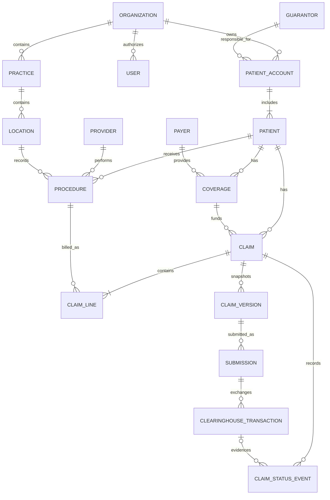
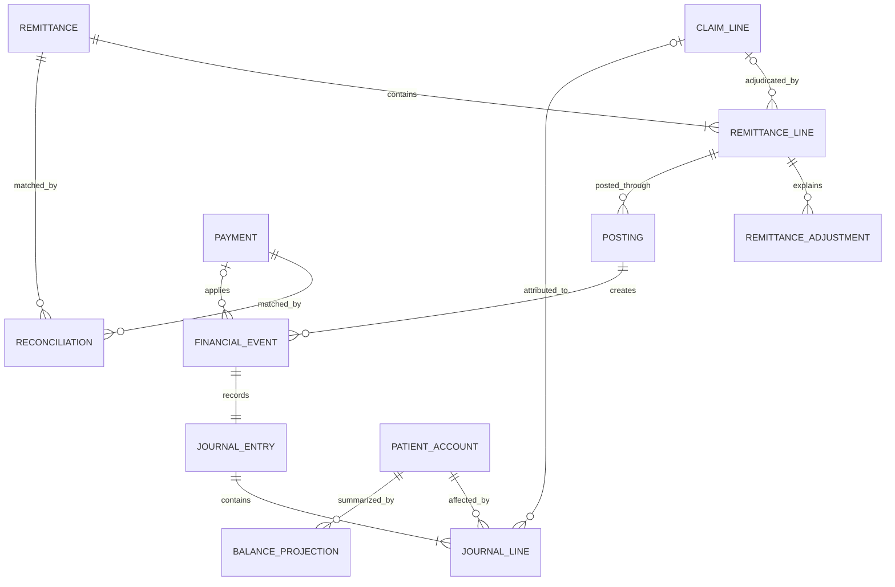

# Claims & Ledger V1 — ER Diagram and Database Schema

## ER Diagram

## Database Schema

This appendix uses PostgreSQL-style logical types. Identifiers comply with IETF UUID RFC 9562,1 monetary values use `numeric(12,2)`, and timestamps use UTC `timestamptz`. Content hashes are lowercase, 64-character SHA-256 digests of canonical source content.11 Short identifiers such as `org-001` are readable aliases for UUID values. Every Example column belongs to the same fictional but realistic record set, and every foreign key includes `organization_id` so a record cannot reference another tenant.

### Example claim outcome

| Event | Concrete example |
|---|---|
| Claim | River Dental submits claim `PB-1001` for Maya's $200 filling. |
| Submission | The claim is sent through `clearinghouse-1` and accepted on the first attempt as `CH1-837-8891`. |
| Adjudication | Insurer A assigns payer claim ID `A-CLAIM-9911`, allows $140, pays $100, applies a $60 contractual adjustment, and assigns $40 to Maya. |
| Remittance | ERA `ERA-A-7788` explains the decision and identifies the payment as `EFT-A-4455`. |
| Bank payment | The practice receives a $100 deposit recorded as `BANK-90210`, with payment trace `EFT-A-4455`. |
| Final balance | Insurance A/R is $0 and Maya's patient balance is $40. |

### Claim preparation

Only the PbN PMS columns consumed by this workflow are shown below. These are the persisted inputs from which a claim is assembled.

#### `organizations`

This table defines the PbN customer and tenant boundary so all billing entities, locations, users, patients, and financial records remain isolated from other customers.

| Column | Type | Key or constraint | Example |
|---|---|---|---|
| `organization_id` | `uuid` | PK | `org-001` |
| `name` | `varchar(150)` | Required | `River Dental Group` |

#### `practices`

This table represents the legal billing entity whose tax ID and billing NPI appear on claims; it is separate because one organization may own multiple billing entities and each billing entity may operate multiple locations.

| Column | Type | Key or constraint | Example |
|---|---|---|---|
| `organization_id` | `uuid` | PK; FK → `organizations` | `org-001` |
| `practice_id` | `uuid` | PK | `practice-001` |
| `legal_name` | `varchar(150)` | Required | `River Dental Associates` |
| `billing_npi` | `char(10)` | Required 10-digit NPI; validate against NPPES13–14 | `1234567893` |
| `tax_id` | `varchar(20)` | Required; encrypted | `12-3456789` |

#### `locations`

This table identifies the physical office where treatment occurred; it is separate from the billing entity because multiple offices may submit claims under the same tax ID and billing NPI.

| Column | Type | Key or constraint | Example |
|---|---|---|---|
| `organization_id` | `uuid` | PK; FK → `organizations` | `org-001` |
| `location_id` | `uuid` | PK | `location-001` |
| `practice_id` | `uuid` | FK → `practices` | `practice-001` |
| `name` | `varchar(150)` | Required | `Downtown Austin office` |
| `address_line_1` | `varchar(150)` | Required | `100 Main Street` |
| `city` | `varchar(80)` | Required | `Austin` |
| `state_code` | `char(2)` | Required U.S. postal abbreviation | `TX` |
| `postal_code` | `varchar(10)` | Required | `78701` |

#### `users`

This table identifies staff members and their roles so approvals, manual corrections, and access can be attributed to a specific authorized person.

| Column | Type | Key or constraint | Example |
|---|---|---|---|
| `organization_id` | `uuid` | PK; FK → `organizations` | `org-001` |
| `user_id` | `uuid` | PK | `user-007` |
| `display_name` | `varchar(150)` | Required | `Ana Patel` |
| `role` | `varchar(30)` | `ORG_ADMIN`, `BILLING_COORDINATOR`, `FINANCE_REVIEWER`, `CLINICAL_PROVIDER`, or `READ_ONLY` | `BILLING_COORDINATOR` |

#### `patient_accounts`

This table is the financial container that holds charges, payments, credits, and balances; multiple patients, such as members of one family, may share one account.15

| Column | Type | Key or constraint | Example |
|---|---|---|---|
| `organization_id` | `uuid` | PK; FK → `organizations` | `org-001` |
| `account_id` | `uuid` | PK | `account-001` |
| `guarantor_id` | `uuid` | FK → `guarantors` | `guarantor-001` |

#### `guarantors`

This table identifies the person legally responsible for paying the account balance; it is separate from the patient because the legally responsible person may not have received treatment.15

| Column | Type | Key or constraint | Example |
|---|---|---|---|
| `organization_id` | `uuid` | PK; FK → `organizations` | `org-001` |
| `guarantor_id` | `uuid` | PK | `guarantor-001` |
| `first_name` | `varchar(80)` | Required | `Maya` |
| `last_name` | `varchar(80)` | Required | `Chen` |
| `address_line_1` | `varchar(150)` | Required | `25 Lake Street` |
| `city` | `varchar(80)` | Required | `Austin` |
| `state_code` | `char(2)` | Required U.S. postal abbreviation | `TX` |
| `postal_code` | `varchar(10)` | Required | `78702` |

#### `patients`

This table identifies the person who receives treatment and whose insurance claim is submitted; it connects that person to a financial account, coverage, procedures, and claims.

| Column | Type | Key or constraint | Example |
|---|---|---|---|
| `organization_id` | `uuid` | PK; FK → `organizations` | `org-001` |
| `patient_id` | `uuid` | PK | `patient-001` |
| `account_id` | `uuid` | FK → `patient_accounts` | `account-001` |
| `first_name` | `varchar(80)` | Required | `Maya` |
| `last_name` | `varchar(80)` | Required | `Chen` |
| `date_of_birth` | `date` | Required | `1990-06-12` |
| `address_line_1` | `varchar(150)` | Required | `25 Lake Street` |
| `city` | `varchar(80)` | Required | `Austin` |
| `state_code` | `char(2)` | Required U.S. postal abbreviation | `TX` |
| `postal_code` | `varchar(10)` | Required | `78702` |

#### `payers`

This table stores each insurer's reusable identity and electronic routing value because many patient coverages and claims may use the same insurer.

| Column | Type | Key or constraint | Example |
|---|---|---|---|
| `organization_id` | `uuid` | PK; FK → `organizations` | `org-001` |
| `payer_id` | `uuid` | PK | `payer-a` |
| `name` | `varchar(150)` | Required | `Insurer A` |
| `electronic_payer_id` | `varchar(50)` | Required clearinghouse routing value | `A001` |

#### `coverages`

This table records a patient's specific insurance policy, subscriber identifier, coverage order, and effective dates; it is separate from the payer because each patient has a distinct policy relationship with the insurer.

| Column | Type | Key or constraint | Example |
|---|---|---|---|
| `organization_id` | `uuid` | PK; FK → `organizations` | `org-001` |
| `coverage_id` | `uuid` | PK | `coverage-001` |
| `patient_id` | `uuid` | FK → `patients` | `patient-001` |
| `payer_id` | `uuid` | FK → `payers` | `payer-a` |
| `subscriber_patient_id` | `uuid` | Nullable FK → `patients`; required when subscriber is a PbN patient | `patient-001` |
| `subscriber_id` | `varchar(80)` | Required identifier assigned to the policyholder by the insurer12 | `A-882410` |
| `coverage_order` | `varchar(20)` | `PRIMARY`, `SECONDARY`, or `TERTIARY` | `PRIMARY` |
| `relationship_to_subscriber` | `varchar(20)` | `SELF`, `SPOUSE`, `CHILD`, or `OTHER` | `SELF` |
| `effective_from` | `date` | Required | `2026-01-01` |
| `effective_to` | `date` | Nullable | `null` |

#### `providers`

This table identifies the clinician who performed treatment and supplies the NPI required to identify that provider on the claim.

| Column | Type | Key or constraint | Example |
|---|---|---|---|
| `organization_id` | `uuid` | PK; FK → `organizations` | `org-001` |
| `provider_id` | `uuid` | PK | `provider-001` |
| `display_name` | `varchar(150)` | Required | `Dr. Elena Ruiz` |
| `npi` | `char(10)` | Required 10-digit NPI; validate against NPPES13–14 | `1234567893` |

#### `procedures`

This table records the completed clinical service and fee that may be billed, giving claim preparation one source procedure to reference and protecting against billing the same procedure twice.

| Column | Type | Key or constraint | Example |
|---|---|---|---|
| `organization_id` | `uuid` | PK; FK → `organizations` | `org-001` |
| `procedure_id` | `uuid` | PK | `procedure-001` |
| `patient_id` | `uuid` | FK → `patients` | `patient-001` |
| `provider_id` | `uuid` | FK → `providers` | `provider-001` |
| `location_id` | `uuid` | FK → `locations` | `location-001` |
| `procedure_code` | `varchar(10)` | Required ADA CDT code valid on `service_date`; complete values in the licensed annual CDT set2–4 | `D2391` |
| `service_date` | `date` | Required | `2026-09-13` |
| `fee` | `numeric(12,2)` | Non-negative | `200.00` |
| `tooth_number` | `varchar(4)` | Nullable ADA designation: `1`–`32` for permanent teeth or `A`–`T` for primary teeth12 | `30` |
| `tooth_surfaces` | `varchar(10)` | Nullable ADA codes `B`, `D`, `F`, `I`, `L`, `M`, or `O`; concatenate multiple codes without spaces12 | `O` |
| `status` | `varchar(20)` | `SCHEDULED`, `COMPLETED`, or `VOIDED` | `COMPLETED` |

#### Inputs mapped to destination columns

| Input column | Supplier | Destination column |
|---|---|---|
| Authenticated `organization_id` | PbN session context | `claims.organization_id`, `claim_lines.organization_id`, `claim_versions.organization_id` |
| `patients.patient_id` | PbN patient record | `claims.patient_id` |
| `patients.account_id` | PbN patient record | `claims.account_id` |
| `coverages.coverage_id` | PbN coverage selected for the claim | `claims.coverage_id` |
| `practices.practice_id` | PbN practice configuration | `claims.practice_id` |
| `procedures.location_id` | Completed procedure | `claims.location_id` |
| `procedures.procedure_id` | Completed procedure | `claim_lines.procedure_id` |
| `procedures.procedure_code` | Clinical staff using ADA CDT | `claim_lines.procedure_code` |
| `procedures.fee` | Practice fee schedule recorded with the procedure | `claim_lines.billed_amount` |
| Patient name, birth date, and address | PbN `patients` record | `claim_versions.claim_snapshot.patient` |
| Coverage subscriber ID, order, and subscriber relationship | PbN `coverages` record | `claim_versions.claim_snapshot.coverage` |
| Payer ID, name, and electronic payer ID | PbN `payers` record | `claim_versions.claim_snapshot.payer` |
| Practice legal name, billing NPI, and tax ID | PbN `practices` record | `claim_versions.claim_snapshot.billing_provider` |
| Treating-provider ID, name, and NPI | PbN `providers` record | `claim_versions.claim_snapshot.treating_provider` |
| Location ID, name, and address | PbN `locations` record | `claim_versions.claim_snapshot.service_location` |
| Procedure date, code, fee, tooth, and surfaces | PbN `procedures` record | `claim_versions.claim_snapshot.lines[]` |
| `users.user_id` | Billing coordinator approving the claim | `claim_versions.approved_by` |

#### Values generated by PbN

| Generated value | Destination column | Generation rule |
|---|---|---|
| Claim identifier | `claims.claim_id` | Generate one UUID when the claim is created. |
| Claim number | `claims.claim_number` | Generate a human-readable identifier unique within the organization. |
| Initial claim state | `claims.processing_status` | Set to `READY` only after required-field validation and approval. |
| Claim-line identifier | `claim_lines.claim_line_id` | Generate one UUID per billed procedure. |
| Claim-line sequence | `claim_lines.line_number` | Assign `1..n` within the claim. |
| Initial claim-line state | `claim_lines.status` | Set to `READY` when the parent claim is approved. |
| Claim-version identifier | `claim_versions.claim_version_id` | Generate one UUID for each approved version. |
| Version number | `claim_versions.version_number` | Start at `1`; increment for each corrected version. |
| Immutable submission snapshot | `claim_versions.claim_snapshot` | Copy the approved source values listed above; never update the snapshot in place. |
| Snapshot hash | `claim_versions.content_hash` | Calculate SHA-256 over the canonical snapshot. |
| Creation and approval times | `claims.created_at`, `claim_versions.approved_at` | Record PbN server time in UTC. |

#### Stage output

| Output record | Exact output at the end of claim preparation |
|---|---|
| `claims` | One row with `processing_status = READY` and `adjudication_outcome = null`. |
| `claim_lines` | One or more rows with `status = READY`. Maya's row contains `procedure_code = D2391` and `billed_amount = 200.00`. |
| `claim_versions` | One approved, immutable row containing the exact source values to be submitted. |
| Submission-stage input | `claim_versions.claim_version_id`; the submission stage uses this version to generate the X12 837D transaction. |

The stage-output table shows the records immediately after approval. The schema examples below show the same records after the full workflow has completed, when their current status is `ADJUDICATED`.

#### `claims`

This table represents the overall payment request sent to one insurer for one patient and coverage, and stores its current processing state.

| Column | Type | Key or constraint | Example |
|---|---|---|---|
| `organization_id` | `uuid` | PK; FK → `organizations` | `org-001` |
| `claim_id` | `uuid` | PK | `claim-001` |
| `patient_id` | `uuid` | FK → `patients` | `patient-001` |
| `account_id` | `uuid` | FK → `patient_accounts` | `account-001` |
| `coverage_id` | `uuid` | FK → `coverages` | `coverage-001` |
| `practice_id` | `uuid` | FK → `practices` | `practice-001` |
| `location_id` | `uuid` | FK → `locations` | `location-001` |
| `claim_number` | `varchar(50)` | Unique within organization | `PB-1001` |
| `processing_status` | `varchar(30)` | `DRAFT`, `NEEDS_CORRECTION`, `READY`, `SUBMITTED`, `ACCEPTED`, `PENDING`, or `ADJUDICATED` | `ADJUDICATED` |
| `adjudication_outcome` | `varchar(30)` | `PAID`, `PARTIALLY_PAID`, `DENIED`, or `null` before adjudication | `PAID` |
| `row_version` | `bigint` | Optimistic concurrency value | `6` |
| `created_at` | `timestamptz` | Required | `2026-09-13T16:00:00Z` |

#### `claim_lines`

This table itemizes the procedures and fees within a claim because insurers adjudicate and adjust individual services, not only the claim total.

| Column | Type | Key or constraint | Example |
|---|---|---|---|
| `organization_id` | `uuid` | PK; FK → `organizations` | `org-001` |
| `claim_line_id` | `uuid` | PK | `claim-line-001` |
| `claim_id` | `uuid` | FK → `claims` | `claim-001` |
| `procedure_id` | `uuid` | FK → `procedures`; one active claim line per procedure | `procedure-001` |
| `line_number` | `smallint` | Unique within claim | `1` |
| `procedure_code` | `varchar(10)` | Required ADA CDT code copied from `procedures`; preserve the code valid on the service date2–4 | `D2391` |
| `billed_amount` | `numeric(12,2)` | Non-negative | `200.00` |
| `status` | `varchar(30)` | `DRAFT`, `READY`, `SUBMITTED`, or `ADJUDICATED` | `ADJUDICATED` |

#### `claim_versions`

This table preserves the exact claim data approved for each submission so a correction creates a new version without changing what was previously sent.

| Column | Type | Key or constraint | Example |
|---|---|---|---|
| `organization_id` | `uuid` | PK; FK → `organizations` | `org-001` |
| `claim_version_id` | `uuid` | PK | `claim-version-001` |
| `claim_id` | `uuid` | FK → `claims` | `claim-001` |
| `version_number` | `integer` | Unique within claim | `1` |
| `claim_snapshot` | `jsonb` | Immutable after approval | `{"patient":{"id":"patient-001","name":"Maya Chen","date_of_birth":"1990-06-12","address":"25 Lake Street, Austin, TX 78702"},"coverage":{"id":"coverage-001","subscriber_id":"A-882410","order":"PRIMARY","relationship":"SELF"},"payer":{"id":"payer-a","name":"Insurer A","electronic_payer_id":"A001"},"billing_provider":{"practice_id":"practice-001","name":"River Dental Associates","npi":"1234567893","tax_id":"12-3456789"},"treating_provider":{"id":"provider-001","name":"Dr. Elena Ruiz","npi":"1234567893"},"service_location":{"id":"location-001","name":"Downtown Austin office","address":"100 Main Street, Austin, TX 78701"},"lines":[{"procedure_id":"procedure-001","service_date":"2026-09-13","code":"D2391","tooth":"30","surfaces":"O","amount":200.00}]}` |
| `content_hash` | `varchar(64)` | Immutable SHA-256 hash of canonical `claim_snapshot`11 | `8b1a...e92c` |
| `approved_by` | `uuid` | FK → `users` | `user-007` |
| `approved_at` | `timestamptz` | Required | `2026-09-13T16:10:00Z` |

### Submission and tracking

#### `submissions`

This table records the controlled delivery of one approved claim version and prevents retries from creating duplicate submissions.

| Column | Type | Key or constraint | Example |
|---|---|---|---|
| `organization_id` | `uuid` | PK; FK → `organizations` | `org-001` |
| `submission_id` | `uuid` | PK | `submission-001` |
| `claim_version_id` | `uuid` | FK → `claim_versions` | `claim-version-001` |
| `idempotency_key` | `varchar(100)` | Unique within organization | `submit-claim-001-v1` |
| `clearinghouse_route` | `varchar(50)` | Required | `clearinghouse-1` |
| `status` | `varchar(30)` | `QUEUED`, `SENT`, `DELIVERY_FAILED`, `ACCEPTED`, or `REJECTED` | `ACCEPTED` |
| `attempt_count` | `integer` | At least 1 | `1` |
| `submitted_at` | `timestamptz` | Nullable until sent | `2026-09-13T16:11:00Z` |

#### `clearinghouse_transactions`

This table preserves each outbound and inbound X12 message, partner identifier, and payload so PbN can correlate responses, investigate failures, and prove what was exchanged.

| Column | Type | Key or constraint | Example |
|---|---|---|---|
| `organization_id` | `uuid` | PK; FK → `organizations` | `org-001` |
| `transaction_id` | `uuid` | PK | `transaction-837-001` |
| `submission_id` | `uuid` | Nullable FK → `submissions` | `submission-001` |
| `claim_id` | `uuid` | Nullable FK → `claims` | `claim-001` |
| `transaction_type` | `varchar(20)` | HIPAA-adopted X12 transaction: `837D`, `276`, `277`, or `835`5 | `837D` |
| `direction` | `varchar(10)` | `OUTBOUND` or `INBOUND` | `OUTBOUND` |
| `partner_message_id` | `varchar(100)` | Unique with clearinghouse and direction when present | `CH1-837-8891` |
| `correlation_id` | `varchar(100)` | Indexed across related messages | `corr-claim-001` |
| `payload_uri` | `text` | Required immutable object location | `object://org-001/837/8891` |
| `payload_hash` | `varchar(64)` | Required SHA-256 hash of canonical transaction payload11 | `71ac...300f` |
| `occurred_at` | `timestamptz` | Required | `2026-09-13T16:11:00Z` |
| `processing_status` | `varchar(30)` | `RECEIVED`, `PROCESSED`, `FAILED`, or `DUPLICATE` | `PROCESSED` |

#### `claim_status_events`

This table keeps the chronological status history received from the clearinghouse or insurer while `claims.processing_status` provides only the latest normalized state.

| Column | Type | Key or constraint | Example |
|---|---|---|---|
| `organization_id` | `uuid` | PK; FK → `organizations` | `org-001` |
| `status_event_id` | `uuid` | PK | `status-004` |
| `claim_id` | `uuid` | FK → `claims` | `claim-001` |
| `transaction_id` | `uuid` | Nullable FK → `clearinghouse_transactions` | `transaction-277-001` |
| `status` | `varchar(30)` | `ACCEPTED`, `PENDING`, `ADJUDICATED`, or `REJECTED` | `ADJUDICATED` |
| `effective_at` | `timestamptz` | Insurer-effective time | `2026-09-20T15:00:00Z` |
| `received_at` | `timestamptz` | PbN ingestion time | `2026-09-20T15:02:00Z` |
| `source_sequence` | `varchar(50)` | Nullable partner ordering value | `4` |
| `status_category_code` | `varchar(10)` | Nullable X12 Claim Status Category Code; complete values in External Code List 5076 | `F1` |
| `status_code` | `varchar(10)` | Nullable X12 Claim Status Code; complete values in External Code List 5087 | `1` |

### Remittance and posting

#### `remittances`

This table represents the payer's electronic remittance advice and its payment trace, which explain the total payment associated with one adjudication batch.

| Column | Type | Key or constraint | Example |
|---|---|---|---|
| `organization_id` | `uuid` | PK; FK → `organizations` | `org-001` |
| `remittance_id` | `uuid` | PK | `remittance-001` |
| `payer_id` | `uuid` | FK → `payers` | `payer-a` |
| `source_transaction_id` | `uuid` | FK → `clearinghouse_transactions` | `transaction-835-001` |
| `era_control_number` | `varchar(100)` | Unique with payer | `ERA-A-7788` |
| `payment_trace` | `varchar(100)` | Indexed payer-supplied X12 835 reassociation trace5 | `EFT-A-4455` |
| `total_payment_amount` | `numeric(12,2)` | Non-negative | `100.00` |
| `received_at` | `timestamptz` | Required | `2026-09-20T16:00:00Z` |
| `status` | `varchar(30)` | `RECEIVED`, `PARSED`, `MATCHED`, `NEEDS_REVIEW`, `POSTED`, or `RECONCILED` | `POSTED` |

#### `remittance_lines`

This table records the payer's decision for each billed service and links that decision back to the corresponding claim line.

| Column | Type | Key or constraint | Example |
|---|---|---|---|
| `organization_id` | `uuid` | PK; FK → `organizations` | `org-001` |
| `remittance_line_id` | `uuid` | PK | `remittance-line-001` |
| `remittance_id` | `uuid` | FK → `remittances` | `remittance-001` |
| `claim_line_id` | `uuid` | Nullable FK → `claim_lines` | `claim-line-001` |
| `payer_claim_id` | `varchar(100)` | Indexed for matching | `A-CLAIM-9911` |
| `service_line_number` | `smallint` | Unique within remittance | `1` |
| `billed_amount` | `numeric(12,2)` | Non-negative | `200.00` |
| `allowed_amount` | `numeric(12,2)` | Non-negative | `140.00` |
| `paid_amount` | `numeric(12,2)` | Non-negative | `100.00` |
| `patient_responsibility_amount` | `numeric(12,2)` | Non-negative | `40.00` |
| `denied_amount` | `numeric(12,2)` | Non-negative | `0.00` |
| `match_status` | `varchar(30)` | `EXACT_MATCH`, `AMBIGUOUS`, or `UNMATCHED` | `EXACT_MATCH` |

#### `remittance_adjustments`

This table records each reason and amount behind a service-line adjustment because one remittance line may contain several independently coded adjustments.

| Column | Type | Key or constraint | Example |
|---|---|---|---|
| `organization_id` | `uuid` | PK; FK → `organizations` | `org-001` |
| `remittance_adjustment_id` | `uuid` | PK | `adjustment-001` |
| `remittance_line_id` | `uuid` | FK → `remittance_lines` | `remittance-line-001` |
| `group_code` | `varchar(10)` | X12 Claim Adjustment Group Code: `CO`, `OA`, `PI`, or `PR`8 | `CO` |
| `reason_code` | `varchar(20)` | Required X12 Claim Adjustment Reason Code; complete values in the CARC list9 | `45` |
| `amount` | `numeric(12,2)` | Non-negative | `60.00` |
| `remark_codes` | `jsonb` | Nullable array of X12 Remittance Advice Remark Codes; complete values in the RARC list10 | `[]` |

#### `postings`

This table controls whether a matched remittance line may create financial records and ensures the same payer decision cannot be posted twice.

| Column | Type | Key or constraint | Example |
|---|---|---|---|
| `organization_id` | `uuid` | PK; FK → `organizations` | `org-001` |
| `posting_id` | `uuid` | PK | `posting-001` |
| `remittance_line_id` | `uuid` | FK → `remittance_lines` | `remittance-line-001` |
| `claim_line_id` | `uuid` | FK → `claim_lines` | `claim-line-001` |
| `posting_mode` | `varchar(20)` | `AUTO` or `MANUAL` | `AUTO` |
| `idempotency_key` | `varchar(100)` | Unique within organization | `post-remline-001-v1` |
| `status` | `varchar(30)` | `PROPOSED`, `AUTO_APPROVED`, `STAFF_APPROVED`, `POSTED`, or `FAILED` | `POSTED` |
| `approved_by` | `uuid` | Nullable FK → `users` | `null` |
| `posted_at` | `timestamptz` | Required when posted | `2026-09-20T16:01:00Z` |
| `row_version` | `bigint` | Optimistic concurrency value | `1` |

#### `financial_events`

This table records each immutable business event that changes money owed or received, allowing corrections to be represented as explicit reversals rather than overwritten history.

| Column | Type | Key or constraint | Example |
|---|---|---|---|
| `organization_id` | `uuid` | PK; FK → `organizations` | `org-001` |
| `financial_event_id` | `uuid` | PK | `financial-payment-001` |
| `posting_id` | `uuid` | Nullable FK → `postings` | `posting-001` |
| `procedure_id` | `uuid` | Nullable FK → `procedures` | `null` |
| `payment_id` | `uuid` | Nullable FK → `payments` | `payment-001` |
| `event_type` | `varchar(30)` | `CHARGE`, `INSURER_PAYMENT`, `CONTRACTUAL_ADJUSTMENT`, `WRITE_OFF`, `PATIENT_RESPONSIBILITY_TRANSFER`, `REVERSAL`, or `VOID` | `INSURER_PAYMENT` |
| `amount` | `numeric(12,2)` | Positive | `100.00` |
| `effective_at` | `timestamptz` | Required | `2026-09-20T16:01:00Z` |
| `reverses_financial_event_id` | `uuid` | Nullable self-FK | `null` |

#### `journal_entries`

This table creates one balanced accounting record for each financial event and links a reversal to the entry it corrects.

| Column | Type | Key or constraint | Example |
|---|---|---|---|
| `organization_id` | `uuid` | PK; FK → `organizations` | `org-001` |
| `journal_entry_id` | `uuid` | PK | `journal-payment-001` |
| `financial_event_id` | `uuid` | Unique FK → `financial_events` | `financial-payment-001` |
| `entry_number` | `varchar(50)` | Unique within organization | `JE-1002` |
| `effective_at` | `timestamptz` | Required | `2026-09-20T16:01:00Z` |
| `posted_at` | `timestamptz` | Required; immutable afterward | `2026-09-20T16:01:00Z` |
| `reverses_journal_entry_id` | `uuid` | Nullable self-FK | `null` |

#### `journal_lines`

This table stores the debit and credit sides of a journal entry so every financial event can be proven to balance.

| Column | Type | Key or constraint | Example |
|---|---|---|---|
| `organization_id` | `uuid` | PK; FK → `organizations` | `org-001` |
| `journal_line_id` | `uuid` | PK | `journal-line-003` |
| `journal_entry_id` | `uuid` | FK → `journal_entries` | `journal-payment-001` |
| `patient_account_id` | `uuid` | FK → `patient_accounts` | `account-001` |
| `claim_line_id` | `uuid` | Nullable FK → `claim_lines` | `claim-line-001` |
| `ledger_account` | `varchar(40)` | `INSURANCE_AR`, `PATIENT_AR`, `CASH`, `SERVICE_REVENUE`, `CONTRACTUAL_ADJUSTMENT`, or `WRITE_OFF` | `CASH` |
| `debit_amount` | `numeric(12,2)` | Non-negative; one side must be zero | `100.00` |
| `credit_amount` | `numeric(12,2)` | Non-negative; one side must be zero | `0.00` |
| `sequence` | `smallint` | Unique within journal entry | `1` |

### Reconciliation and balances

#### `payments`

This table records money actually received from an insurer or patient; it is separate from a remittance because an explanation of payment and the bank deposit can arrive independently.

| Column | Type | Key or constraint | Example |
|---|---|---|---|
| `organization_id` | `uuid` | PK; FK → `organizations` | `org-001` |
| `payment_id` | `uuid` | PK | `payment-001` |
| `source_type` | `varchar(20)` | `INSURER` or `PATIENT` | `INSURER` |
| `source_identifier` | `uuid` | Payer or patient identifier | `payer-a` |
| `amount` | `numeric(12,2)` | Positive | `100.00` |
| `payment_trace` | `varchar(100)` | Indexed payer-supplied X12 835 reassociation trace5 | `EFT-A-4455` |
| `bank_transaction_id` | `varchar(100)` | Unique when present | `BANK-90210` |
| `received_at` | `timestamptz` | Required | `2026-09-20T17:00:00Z` |
| `status` | `varchar(30)` | `RECEIVED`, `MATCHED`, `UNMATCHED`, or `REVERSED` | `MATCHED` |

#### `reconciliations`

This table matches a remittance to the corresponding payment and records any amount difference that staff must resolve.

| Column | Type | Key or constraint | Example |
|---|---|---|---|
| `organization_id` | `uuid` | PK; FK → `organizations` | `org-001` |
| `reconciliation_id` | `uuid` | PK | `reconciliation-001` |
| `remittance_id` | `uuid` | FK → `remittances` | `remittance-001` |
| `payment_id` | `uuid` | FK → `payments` | `payment-001` |
| `matched_amount` | `numeric(12,2)` | Non-negative | `100.00` |
| `difference_amount` | `numeric(12,2)` | May be positive or negative | `0.00` |
| `status` | `varchar(30)` | `PENDING`, `MATCHED`, `RECONCILED`, or `MISMATCH` | `RECONCILED` |
| `resolved_by` | `uuid` | Nullable FK → `users` | `null` |
| `resolution_reason` | `text` | Nullable | `null` |
| `resolved_at` | `timestamptz` | Nullable | `null` |

#### `balance_projections`

This table provides fast claim and patient-balance views calculated from the ledger while preserving journal entries as the financial source of truth.

| Column | Type | Key or constraint | Example |
|---|---|---|---|
| `organization_id` | `uuid` | PK; FK → `organizations` | `org-001` |
| `projection_id` | `uuid` | PK | `balance-001` |
| `account_id` | `uuid` | FK → `patient_accounts` | `account-001` |
| `claim_id` | `uuid` | Nullable FK → `claims` | `claim-001` |
| `projection_type` | `varchar(20)` | `CLAIM`, `PATIENT_ACCOUNT`, `PRACTICE`, or `ORGANIZATION` | `CLAIM` |
| `insurance_balance` | `numeric(12,2)` | Derived from ledger | `0.00` |
| `patient_balance` | `numeric(12,2)` | Derived from ledger | `40.00` |
| `last_journal_sequence` | `bigint` | Monotonically increasing | `4` |
| `calculated_at` | `timestamptz` | Required | `2026-09-20T17:01:00Z` |
| `row_version` | `bigint` | Optimistic concurrency value | `4` |

### Workflow control and audit

#### `exception_cases`

This table turns a failure or ambiguous result into owned staff work so unresolved cases cannot proceed through unsafe automated posting.

| Column | Type | Key or constraint | Example |
|---|---|---|---|
| `organization_id` | `uuid` | PK; FK → `organizations` | `org-001` |
| `exception_id` | `uuid` | PK | `exception-002` |
| `exception_type` | `varchar(30)` | `REJECTION`, `DENIAL`, `PARTIAL_PAYMENT`, `DUPLICATE`, `UNMATCHED_REMITTANCE`, or `REVERSAL` | `UNMATCHED_REMITTANCE` |
| `subject_type` | `varchar(30)` | `CLAIM`, `SUBMISSION`, `REMITTANCE_LINE`, `POSTING`, `PAYMENT`, or `RECONCILIATION` | `REMITTANCE_LINE` |
| `subject_id` | `uuid` | Required polymorphic reference | `remittance-line-002` |
| `reason` | `text` | Required | `ERA references payer claim A-CLAIM-8844, but no PbN claim line has that identifier` |
| `status` | `varchar(20)` | `OPEN`, `IN_PROGRESS`, or `RESOLVED` | `OPEN` |
| `owner_id` | `uuid` | Nullable FK → `users` | `user-007` |
| `next_action` | `text` | Required | `Search Maya Chen's claims and select the correct filling before posting` |
| `resolution` | `text` | Nullable | `null` |
| `resolved_at` | `timestamptz` | Nullable | `null` |

#### `audit_events`

This table records who or what performed each material action, when it occurred, and which source evidence supports it.

| Column | Type | Key or constraint | Example |
|---|---|---|---|
| `organization_id` | `uuid` | PK; FK → `organizations` | `org-001` |
| `audit_event_id` | `uuid` | PK | `audit-019` |
| `actor_type` | `varchar(20)` | `USER`, `SERVICE`, or `EXTERNAL` | `SERVICE` |
| `actor_id` | `varchar(100)` | Required | `posting-service` |
| `action` | `varchar(50)` | `CLAIM_CREATED`, `CLAIM_APPROVED`, `CLAIM_SUBMITTED`, `CLAIM_STATUS_UPDATED`, `REMITTANCE_RECEIVED`, `REMITTANCE_MATCHED`, `POSTING_APPROVED`, `REMITTANCE_POSTED`, `PAYMENT_RECEIVED`, `PAYMENT_MATCHED`, `RECONCILIATION_COMPLETED`, `EXCEPTION_OPENED`, `EXCEPTION_RESOLVED`, or `FINANCIAL_EVENT_REVERSED` | `REMITTANCE_POSTED` |
| `subject_type` | `varchar(30)` | `CLAIM`, `SUBMISSION`, `REMITTANCE`, `POSTING`, `PAYMENT`, `RECONCILIATION`, or `EXCEPTION` | `POSTING` |
| `subject_id` | `uuid` | Required polymorphic reference | `posting-001` |
| `source_id` | `varchar(100)` | Nullable evidence identifier | `transaction-835-001` |
| `correlation_id` | `varchar(100)` | Indexed | `corr-claim-001` |
| `event_at` | `timestamptz` | Required | `2026-09-20T16:01:00Z` |
| `metadata_hash` | `varchar(64)` | Required SHA-256 hash of canonical audit metadata11 | `5cad...11b8` |

### Example financial rows

The $200 filling produces four business events. Each event has one immutable journal entry whose debit and credit lines balance.

| Event | Debit | Credit | Amount |
|---|---|---|---:|
| Completed procedure | Insurance A/R | Service revenue | $200.00 |
| Insurer payment | Cash | Insurance A/R | $100.00 |
| Contractual adjustment | Contractual adjustment | Insurance A/R | $60.00 |
| Transfer to patient | Patient A/R | Insurance A/R | $40.00 |

After these entries, Insurance A/R is $0 and Patient A/R is $40. The ERA payment of $100 matches the EFT payment of $100, so `reconciliations.status` becomes `RECONCILED` and the balance projection shows a $0 insurance balance and a $40 patient balance.

### References

1. Internet Engineering Task Force, “[RFC 9562: Universally Unique IDentifiers (UUIDs)](https://www.rfc-editor.org/rfc/rfc9562),” May 2024.
2. American Dental Association, “[The Code on Dental Procedures and Nomenclature](https://www.ada.org/publications/cdt).”
3. American Dental Association, “[CDT 2026 and Coding Companion Kit with App](https://engage.ada.org/p/pb/cdt-2026-coding-kit-2336),” 2026.
4. American Dental Association, “[Licensing for Commercial Users](https://www.ada.org/publications/ada-store-products/licensing-for-commercial-users).”
5. Centers for Medicare & Medicaid Services, “[Adopted Standards and Operating Rules](https://www.cms.gov/priorities/key-initiatives/burden-reduction/administrative-simplification/hipaa/adopted-standards-operating-rules).”
6. X12, “[Claim Status Category Codes](https://x12.org/codes/claim-status-category-codes),” External Code List 507.
7. X12, “[Claim Status Codes](https://x12.org/codes/claim-status-codes),” External Code List 508.
8. X12, “[Claim Adjustment Group Codes](https://x12.org/codes/claim-adjustment-group-codes).”
9. X12, “[Claim Adjustment Reason Codes](https://x12.org/codes/claim-adjustment-reason-codes).”
10. X12, “[Remittance Advice Remark Codes](https://x12.org/codes/remittance-advice-remark-codes).”
11. National Institute of Standards and Technology, “[FIPS PUB 180-4: Secure Hash Standard](https://csrc.nist.gov/pubs/fips/180-4/upd1/final),” August 2015.
12. American Dental Association, “[ADA Dental Claim Form](https://www.ada.org/publications/cdt/ada-dental-claim-form),” including the tooth-designation and tooth-surface value sets.
13. Centers for Medicare & Medicaid Services, “[National Provider Identifier Standard](https://www.cms.gov/regulations-and-guidance/administrative-simplification/nationalprovidentstand).”
14. Centers for Medicare & Medicaid Services, “[NPPES NPI Files](https://download.cms.gov/nppes/NPI_Files.html).”
15. HL7 International, “[FHIR Account—Detailed Descriptions](https://hl7.org/fhir/account-definitions.html),” Release 5.
