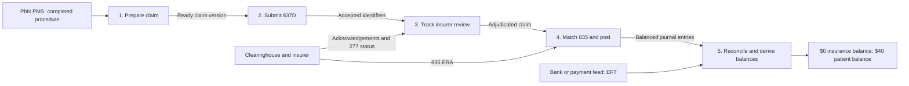
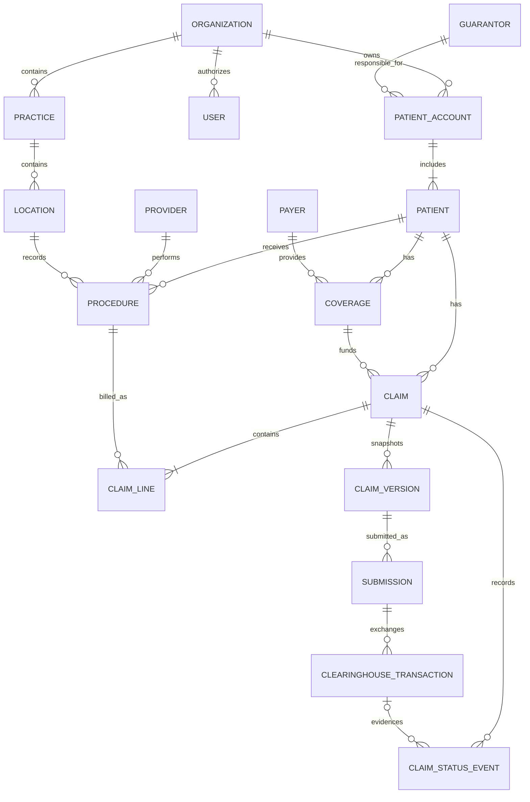
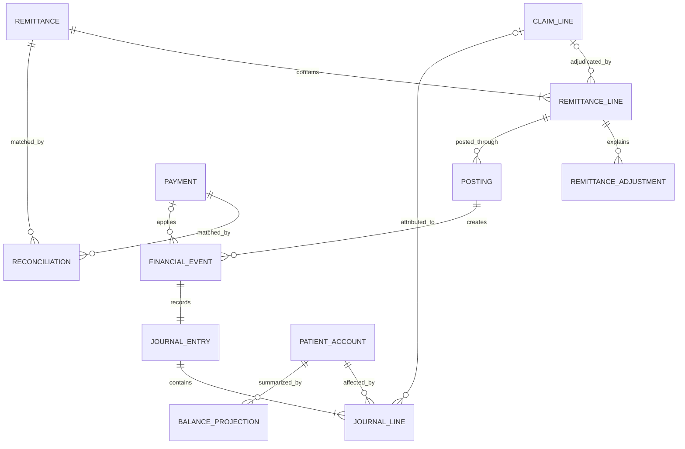

# Claims & Ledger V1 — Product and Technical Specification

## Submission Coverage

The requested submission covers seven areas: product and workflow design; system architecture, sources of truth, multi-tenancy, and ledger design; the core data model; API contracts; reliability, idempotency, and reconciliation; rollout and production validation; and assumptions, exclusions, and AI usage. This specification follows that coverage. See [assignment.txt](assignment.txt) for the detailed requirements.

## Strategy Context

### Product boundary

Claims & Ledger manages the financial journey from completed dental treatment to the insurer's decision and the patient's final balance. A claim is the practice's request for insurance payment. The ledger is the permanent financial history of the resulting charges, insurer payments, adjustments, patient responsibility, and corrections.

For example, after a dentist completes a $200 filling, the billing coordinator confirms the patient, insurer, dentist, procedure, and fee before creating and submitting the claim through a clearinghouse. If the insurer allows $140, pays $100, assigns $40 to the patient, and requires a $60 contractual adjustment, the ledger records each amount and explains why the patient owes $40.

### Customer problem

Billing staff lack one reliable workflow to create an accurate claim, track it through the insurer's decision, and record the correct financial outcome. The work can span PbN's PMS, the clearinghouse, the insurer portal, the payment explanation, and the bank record, each updating at a different time. Staff repeatedly search, compare, enter, and recheck information while handling rejections, delays, denials, partial payments, duplicates, corrections, and reversals. A missed rejection delays payment, a duplicate posting overstates collections, and an incorrect adjustment can produce the wrong patient bill.

### Target customer and users

The initial target customer is a U.S. multi-location dental group that accepts insurance, uses PbN as its dental PMS, and centralizes some or all insurance billing. Its claim volume and cross-location handoffs create a clear need for automation, while organization, practice, and location boundaries provide a path to serve independent practices and enterprise DSOs later.

The buyer is the owner or operations leader. The billing coordinator is the primary user who creates and tracks claims, resolves exceptions, and posts insurer decisions. Revenue leaders monitor collections and financial exceptions, front-desk staff collect and explain patient balances, and patients receive accurate bills.

### Claims workflow

| Stage | What happens | Common pain |
|---|---|---|
| 1. Claim preparation | After treatment is completed, the system converts the recorded procedures into an insurance claim. It verifies the patient, insurance plan, dentist, procedure codes, fees, and required documents. This stage ends when the claim is complete and ready to submit. | Required data is incomplete, inconsistent, or repeatedly entered. |
| 2. Submission | The system sends the claim through a clearinghouse to the insurer. The clearinghouse and insurer check whether they can accept it for review. If they reject it because information is missing or invalid, staff correct and resubmit it. Acceptance means the insurer will review the claim, not that it will pay it. | Clearinghouse and insurer responses or rejections require staff to search and rework data. |
| 3. Claim tracking | The insurer reviews the accepted claim, a process called adjudication. During this period, the claim may remain pending or require additional information. Staff need one place to see its status, owner, deadline, and next action. This stage ends when the insurer makes a payment decision. | Claim statuses and requests for more information are fragmented across systems. |
| 4. Remittance and posting | The insurer sends an ERA or EOB explaining what it paid, denied, adjusted, or assigned to the patient. The system matches this decision to the correct claim and procedures, then records the resulting financial entries in the ledger. Ambiguous matches require staff review. | Staff must translate the decision into payments, adjustments, denials, and patient responsibility. |
| 5. Reconciliation and balances | The system confirms that the insurer's payment matches the ERA/EOB and the ledger entries. It then calculates the remaining insurance and patient balances. Any mismatch becomes an exception for staff to resolve. This stage ends when the payment is accounted for and every balance can be explained. | The ERA/EOB, bank deposit, ledger, and patient balance may disagree. |

Exception handling cuts across all five stages. Each exception enters a staff queue with its reason, owner, and next action, and may return the claim to an earlier stage for correction and resubmission.

### Scope definitions

Claim coverage defines which insurance scenarios PbN supports: primary, secondary, or tertiary claims after treatment, and predeterminations before treatment. The choice changes where the workflow begins, how many insurer decisions it must coordinate, and when the patient's balance becomes final.

Transaction channel defines the form in which PbN exchanges claims and insurer responses: structured electronic transactions, human-readable documents, or both. The choice changes how PbN receives, validates, matches, and posts the information and how much staff verification is required.

Connection route defines the path used to exchange information with an insurer: one clearinghouse, multiple clearinghouses, a direct insurer connection, or a combination. An electronic 837D is the package; the connection route is the courier. The choice changes how PbN enrolls providers, routes transactions, tracks external identifiers, monitors failures, and prevents duplicate submissions.

Supported exceptions define which non-standard outcomes staff can resolve completely inside PbN. Displaying an error is not sufficient: staff must be able to take the required action and return the claim to a correct payment and balance.

The automation boundary determines whether a staff member, deterministic rule, or AI model decides and completes each action. The choice determines when staff approval is required and how much risk PbN assumes when an action changes a claim or financial balance.

### Selected initial scope

| Scope dimension | Selected option(s) | Why |
|---|---|---|
| Claim coverage | Primary completed-treatment claims | Each claim follows one insurer decision before PbN calculates the patient balance, avoiding the dependent workflows required for secondary and tertiary claims and the separate pre-treatment workflow required for predeterminations. |
| Transaction channel | Electronic support | Structured claim, status, and remittance data can be validated and matched without document extraction or manual re-entry. |
| Connection route | One clearinghouse | Every supported claim follows one partner connection, avoiding routing and monitoring across multiple clearinghouses or direct insurer integrations. |
| Supported exceptions | Core exception support for rejection, denial, partial payment, duplicate, unmatched remittance, and reversal | These exceptions keep the claim and financial record correct without adding the clinical evidence, correspondence, deadlines, and repeated follow-up required for full appeal management. |
| Automation boundary | Manual processing for claim submissions; deterministic automation for exact, balanced remittance matches; AI assistance for ambiguous matches | Routine financial cases move automatically, AI helps staff investigate ambiguity, and no probabilistic decision changes a claim or balance without approval. Autonomous AI is excluded. |

The resulting scope supports primary completed-treatment claims through one clearinghouse and electronic transactions. PbN handles six core exception types, automates exact financial matches, assists staff with ambiguous matches, and requires staff approval before submitting claims.

## Requirements

### Functional Requirements

The requirements follow the same five stages as the customer workflow. Each stage begins with the outcome the customer needs, followed by the PbN behavior and acceptance conditions that deliver it. A requirement may draw from the required product capabilities,1 the selected scope, an industry standard, or a product-design decision. The ADA Dental Claim Form defines the information used to report dental treatment,2 while the adopted X12 transactions define electronic claim submission, status exchange, and remittance.3–5

#### 1. Claim preparation

The billing coordinator can turn completed insured treatment into an accurate, submission-ready primary claim without re-entering information or billing the same procedure twice.

| ID | PbN behavior | Acceptance condition | Source |
|---|---|---|---|
| FR-01 | When a dentist marks an insured procedure complete, PbN creates or updates a draft primary claim using the patient and subscriber relationship, insurance plan, treating and billing providers, service date, location, CDT procedure, tooth or surface when applicable, fee, and supporting information already recorded in PbN. | Every eligible completed procedure is linked to exactly one claim line, and the copied information matches its source record. Reprocessing the same procedure returns the existing claim and creates nothing new. | 1,2 |
| FR-02 | PbN validates the draft before submission, identifies each missing or invalid field, and allows the billing coordinator to correct the claim and rerun validation. | PbN identifies every blocking error and cannot mark the claim ready to submit until those errors are resolved. | 1,2 |
| FR-03 | When the billing coordinator approves a valid draft, PbN changes the claim from `DRAFT` to `READY` and creates an immutable `ClaimVersion` containing the exact approved claim data. | Editing a `DRAFT` claim creates no version. Approval creates exactly one version containing the approved values. If an approved claim is edited and approved again, PbN creates the next version and leaves every earlier version unchanged. | Product-design decision |

#### 2. Submission

The billing coordinator can approve and send a valid claim once, then see whether the clearinghouse or insurer accepted it for payment review or rejected it for correction.

| ID | PbN behavior | Acceptance condition | Source |
|---|---|---|---|
| FR-04 | Before sending a claim, PbN compares the patient, payer, provider, service date, procedures, and amounts against previously submitted claims and identifies possible duplicates. | PbN does not transmit a possible duplicate until the billing coordinator reviews the matching claim and records a reason to proceed. The decision remains in the audit history. | 1 |
| FR-05 | After staff approval, PbN converts the ready claim to an X12 837D transaction and sends it through the selected clearinghouse. PbN records every attempt, timestamp, request identifier, clearinghouse identifier, and response. | Repeating the same approved submission request creates no second external submission. | 1,3 |
| FR-06 | PbN records clearinghouse and insurer acknowledgements separately from the insurer's payment decision. A rejection identifies the reason and returns the claim to the billing coordinator for correction and resubmission. | Staff can distinguish ready, submitted, accepted for review, and rejected claims and can see the next required action. | 1,3 |

#### 3. Claim tracking

The billing coordinator can see where every accepted claim is in the insurer's review process and what action, owner, or follow-up is required.

| ID | PbN behavior | Acceptance condition | Source |
|---|---|---|---|
| FR-07 | PbN obtains claim-status responses through the clearinghouse, including X12 276/277 exchange where supported, and maintains the full status history. | Staff can distinguish accepted, pending, denied, and adjudicated claims. A delayed or repeated response cannot erase newer history or incorrectly move the current status backward. | 1,3,4 |

#### 4. Remittance and posting

The billing coordinator can convert the insurer's decision into correct financial entries, with exact matches posted automatically and ambiguous cases held for review.

| ID | PbN behavior | Acceptance condition | Source |
|---|---|---|---|
| FR-08 | PbN receives X12 835 ERAs electronically and stores the original transaction before parsing its payment, claim, service-line, adjustment, reason-code, patient-responsibility, and payment-trace information. Paper EOB ingestion and automated extraction are deferred. | PbN can reproduce the source information used for every proposed or completed posting. | 1,3,5 |
| FR-09 | PbN automatically posts a remittance only when the insurer, claim, service lines, payment, adjustments, and responsibility amounts match exactly and account for the adjudicated amount. An ambiguous or unbalanced remittance enters a work queue without changing the ledger. | Every automatic posting identifies the matched claim lines and proves that the posted components balance to the insurer's decision. | 1,5 |
| FR-10 | The billing coordinator can review an unmatched remittance, select the correct claim and service lines, correct the proposed allocation, and approve posting. | Manual posting records the original proposal, final allocation, approving user, time, and reason for each change. | 1 |
| FR-11 | Posting records insurer payments, contractual adjustments or write-offs, denials, and patient responsibility at the applicable claim or service-line level. A reversal adds entries that cancel the earlier financial effect without deleting its history. | Charges equal insurer payments, patient responsibility, contractual adjustments, and any remaining insurance responsibility for each adjudicated service line. | 1,5 |

#### 5. Reconciliation and balances

Practice staff can confirm that the insurer's explanation, bank payment, ledger entries, and remaining balances agree and can trace every displayed balance to its source.

| ID | PbN behavior | Acceptance condition | Source |
|---|---|---|---|
| FR-13 | PbN maintains separate insurance and patient responsibility for each service line and rolls those amounts into claim, patient-account, guarantor-account, practice, and organization views. | Every displayed balance can be traced to the contributing charges, payments, adjustments, responsibility transfers, and reversals. | 1 |
| FR-14 | PbN connects each ERA to its corresponding EFT using the payment trace information and places unmatched or unequal amounts in a reconciliation queue. | A remittance is not marked reconciled until its payment amount equals the matched bank payment or an authorized user records a documented resolution. | 1,3,5 |

#### Behavior across all five stages

Staff can resolve the supported exceptions inside PbN and see a complete history of every claim and financial change.

| ID | PbN behavior | Acceptance condition | Source |
|---|---|---|---|
| FR-12 | PbN supports six exception workflows: rejection correction and resubmission, denial routing, partial payment, duplicate prevention, unmatched-remittance review, and reversal. | Each exception displays its reason, owner, next action, supporting source, and resolution history; full appeal management remains outside the initial scope. | 1 |
| FR-15 | Authorized users can view a chronological claim and financial history containing every user action, system action, external message, posting, and correction. | The history identifies what happened, when it happened, who or what caused it, and the source record used. | 1,6 |

### Non-Functional Requirements

These requirements define the conditions under which the functional workflow remains safe. They derive from PbN's explicit requirements for correctness, auditability, multi-tenancy, and unreliable integrations. HHS requires regulated systems to protect the confidentiality, integrity, and availability of electronic protected health information and to implement access, audit, authentication, integrity, and transmission controls.1,6

| ID | Requirement | Acceptance condition | Source |
|---|---|---|---|
| NFR-01 | Every claim, remittance, ledger entry, balance projection, audit event, API request, and asynchronous message is scoped to one organization and, when applicable, one practice and location. | A user or service authenticated for one organization can never read, create, update, or process another organization's data. | 1,6 |
| NFR-02 | PbN authorizes every action using the authenticated user's organization, role, practice, and location access. Financial corrections and write-offs require an explicitly permitted role. | Changing a tenant or location identifier in a request never expands the caller's access. | 1,6 |
| NFR-03 | Claim submission, status ingestion, ERA import, remittance posting, ledger creation, and event consumption are idempotent. | Repeating the same request or receiving the same external message any number of times produces one claim submission and one set of financial effects. | 1 |
| NFR-04 | PbN preserves every accepted external message and processes retries durably when the clearinghouse or an internal dependency is unavailable. | A retry, timeout, duplicate, or delayed response causes no lost claim update and no duplicate financial effect. | 1 |
| NFR-05 | Claim status is derived from the complete ordered event history rather than the arrival order alone. | A late or out-of-order response cannot overwrite a later valid state; conflicting responses enter an exception queue. | 1 |
| NFR-06 | Concurrent posting is controlled using a version or equivalent concurrency check, and each claim-line posting has a unique financial-operation identifier. | If two users post the same remittance, one operation succeeds and the other receives the current result without creating additional entries. | 1 |
| NFR-07 | Each remittance line posts atomically. A multi-line remittance may contain posted and failed lines, but it remains incomplete until every line is posted or resolved. | Retrying failed lines does not repeat successful lines, and the remittance shows the status and error for every line. | 1 |
| NFR-08 | Posted financial records are immutable. Corrections, voids, and reversals create linked compensating entries. | No API, user, or background process can update or delete the amount of a posted entry. | 1,6 |
| NFR-09 | Displayed balances are projections of posted ledger facts and include an as-of time. PbN regularly recomputes them from the ledger and compares the result with the stored projection. | Any non-zero difference creates a reconciliation incident; rebuilding the projection changes no ledger entry. | 1 |
| NFR-10 | PbN records an append-only audit event for every claim-state change, external message, approval, posting, access-controlled correction, and administrative action. | Each event contains the tenant, actor or service, action, timestamp, affected record, correlation identifier, and source evidence. | 1,6 |
| NFR-11 | PbN protects electronic protected health information in storage and transit, authenticates every user and service, applies least-privilege access, and records access and security-relevant activity. | Security testing confirms that unauthenticated, unauthorized, and cross-tenant requests cannot access protected data and that protected transmissions cannot be read or modified in transit. | 6 |
| NFR-12 | PbN monitors submission failures, unprocessed messages, retry exhaustion, duplicate detection, posting failures, unresolved exceptions, unreconciled payments, balance drift, and cross-tenant authorization failures. | Each condition has an owner, alert, affected-record identifier, and documented replay, recomputation, or escalation path. | 1,6 |

## Supporting Technical Design

### Workflow, Screens, and Data Flow

The happy path uses the $200 filling from the product-boundary example. The claim is complete, the clearinghouse and insurer accept it on the first submission, and the insurer sends an electronic decision that allows $140, pays $100, applies a $60 contractual adjustment, and assigns $40 to the patient. The $100 EFT reaches the practice and matches the ERA.

An editable field accepts or corrects staff input. A selectable field constrains staff to valid choices. A read-only field displays source or derived data without creating a second copy for staff to maintain. A system value is stored and used by PbN but is not a form field. The source column identifies the system of record for each value.

#### 1. Claim preparation

The claim-preparation screen opens from the completed-treatment work queue. It shows the information PbN already holds, highlights blocking errors, and asks the billing coordinator to correct or approve the claim rather than re-enter it.

| Contract element | Definition |
|---|---|
| Actors | The dentist completes the procedure. PbN creates and validates the draft. The billing coordinator reviews exceptions, corrects source data, and approves the claim. |
| Trigger | A procedure changes to `Completed` while active primary insurance coverage exists for its service date. |
| Inputs | PbN reads the patient, guarantor, coverage, payer, providers, practice, location, service date, CDT code, tooth or surface, fee, and supporting information from its PMS. PbN also reads existing claims for the same patient and procedure to detect duplicates. |
| PbN actions | PbN creates one `Claim`, links each eligible `Procedure` through a `ClaimLine`, records the $200 charge, validates required fields, and searches for possible duplicates. |
| User actions | The billing coordinator reviews the pre-populated claim, corrects blocking information in the relevant PMS record, resolves any duplicate warning, adds required attachments, and selects **Mark ready**. |
| Decision | Are all required fields valid, is each procedure linked to no other active claim, and are required attachments present? |
| Outputs | PbN creates an immutable approved `ClaimVersion`, records the approval in `AuditEvent`, and makes the claim eligible for submission. |
| State transition | `Claim: Draft → Ready`. A blocking error or unresolved duplicate produces `Claim: Needs correction`; no submission is created. |

| Screen element | UX control | Value shown or accepted | Source and system of record |
|---|---|---|---|
| Patient and guarantor | Read-only summary with links to edit the source record | Name, date of birth, address, relationship, and account | `Patient`, `PatientAccount`, and `Guarantor` in PbN PMS |
| Primary coverage | Selectable only when more than one active primary record is valid | Payer, member or subscriber ID, group number, relationship, effective dates | `Coverage` and `Payer` in PbN PMS |
| Billing and treating providers | Selectable from providers authorized for the practice | Provider names, identifiers, and practice information | `Provider`, `Practice`, and credential records in PbN PMS |
| Treatment details | Read-only summary with a link to correct the procedure record | Service date, location, CDT code, tooth, surface, and description | Completed `Procedure` in PbN PMS |
| Claim lines and fees | Read-only rows; eligible completed procedures can be included or excluded | Procedure, line number, and billed amount | `Procedure` and its recorded fee in PbN PMS; the selection creates `ClaimLine` |
| Supporting information | Attachment selector | Existing or newly attached image, narrative, or supporting document | Procedure attachments and document store in PbN PMS |
| Validation results | Read-only error list with links to the affected fields | Missing, invalid, or inconsistent values | Claims validation rules applied to the draft `Claim` |
| Possible duplicate | Review panel with **Use existing claim** or **Proceed with reason** | Matching claim, procedure, date, payer, and amount | Existing `Claim` and `ClaimLine` records; decision and reason stored in `AuditEvent` |
| Mark ready | Primary action button | Approval of the displayed claim snapshot | Authenticated `User`; creates immutable `ClaimVersion` and changes `Claim.processing_status` |

#### 2. Submission

The submission screen presents the approved claim version and its destination. The billing coordinator makes one explicit submission decision; PbN generates the technical identifiers and manages delivery retries.

| Contract element | Definition |
|---|---|
| Actors | The billing coordinator authorizes submission. PbN creates and sends the transaction. The clearinghouse and insurer return delivery and acceptance acknowledgements. |
| Trigger | The billing coordinator selects **Submit claim** for a claim in `Ready`. |
| Inputs | PbN reads the approved `ClaimVersion`, the payer's configured clearinghouse route, and the authenticated user. PbN generates the submission idempotency key. |
| PbN actions | PbN creates `Submission` in `Queued`, renders the approved version as an 837D transaction, sends it through the configured clearinghouse, and stores the original transaction and every acknowledgement. |
| User actions | The billing coordinator reviews the read-only claim summary and destination, then selects **Submit claim**. A rejected claim is opened in claim preparation for correction and a new version. |
| Decision | Did the clearinghouse and insurer accept the transaction for payment review? Acceptance confirms receipt and validation, not payment. |
| Outputs | PbN retains the submitted claim snapshot, internal and external identifiers, attempt history, timestamps, acknowledgements, and any rejection reason. |
| State transition | `Claim: Ready → Submitted → Accepted` and `Submission: Queued → Sent → Accepted`. A delivery failure retains the logical submission for retry. A rejection produces `Submission: Rejected` and `Claim: Needs correction`. |

| Screen element | UX control | Value shown or accepted | Source and system of record |
|---|---|---|---|
| Approved claim summary | Read-only review | Patient, payer, providers, service lines, total charge, and attachments | Immutable `ClaimVersion` created during claim preparation |
| Destination | Read-only value in the initial scope | Clearinghouse and payer | Payer-routing configuration; one clearinghouse is supported initially |
| Submit claim | Primary action button | Authorization to send the approved version | Authenticated `User`; creates `Submission` |
| Submission key | System value; not displayed as an editable field | Unique key for this claim version and logical submission | Generated by PbN and stored in `Submission.idempotency_key` |
| Delivery state | Read-only status with timestamp | Queued, sent, delivery failed, or delivered | `Submission` and outbound `ClearinghouseTransaction` |
| Acceptance state | Read-only status with source details | Accepted or rejected for insurer review | Inbound clearinghouse or insurer acknowledgement stored as `ClearinghouseTransaction` and `ClaimStatusEvent` |
| Rejection details | Read-only reason with **Correct claim** action | Rejection code, plain-language reason, affected field, and received time | Clearinghouse or insurer acknowledgement; correction occurs in the source PMS record and creates a new `ClaimVersion` |

#### 3. Claim tracking

The claim-tracking screen is a status timeline and work queue, not a data-entry form. PbN ingests external status events automatically; staff supply only ownership, follow-up, or resolution information when action is required.

| Contract element | Definition |
|---|---|
| Actors | The clearinghouse or insurer supplies status. PbN ingests and orders each response. The billing coordinator monitors pending claims and completes follow-up tasks. |
| Trigger | PbN receives an unsolicited status response or reaches the scheduled time to request the next status through the clearinghouse. |
| Inputs | PbN reads the claim, submission, PbN identifier, clearinghouse identifier, insurer identifier, existing ordered status history, and the latest 277 or equivalent electronic response. |
| PbN actions | PbN stores the source response, correlates it to one claim, appends a `ClaimStatusEvent`, derives the current status from the ordered history, and creates a task when a response is missing or conflicting. |
| User actions | The billing coordinator reviews the current status and timeline, assigns or completes follow-up work, and supplies requested information through the applicable correction workflow. Staff do not type the insurer's status. |
| Decision | Is the claim still awaiting the insurer's decision, does staff action remain, or has adjudication completed? |
| Outputs | The current status, complete status history, last update, source, owner, next action, and follow-up date are visible from one claim record. |
| State transition | `Claim: Accepted → Pending → Adjudicated`. A delayed response leaves the last confirmed state unchanged and opens an `ExceptionCase`; a conflicting response is retained but cannot move the claim backward automatically. |

| Screen element | UX control | Value shown or accepted | Source and system of record |
|---|---|---|---|
| Current claim status | Read-only status | Accepted, pending, or adjudicated | Derived from ordered `ClaimStatusEvent` records |
| Identifier panel | Read-only values | PbN claim number, submission ID, clearinghouse ID, and insurer claim ID | `Claim`, `Submission`, and `ClearinghouseTransaction` |
| Status timeline | Read-only chronological list | Status, effective time, received time, source, and reason | Append-only `ClaimStatusEvent` and its source `ClearinghouseTransaction` |
| Owner and next action | Assignee selector and task action | Responsible billing coordinator and required follow-up | `ExceptionCase`; valid assignees come from authorized `User` records |
| Follow-up date | Date field when a task is open | Next date on which staff or PbN should act | Queue rule supplies the default; staff change is stored on `ExceptionCase` and audited |
| Check status | Secondary action button | Request for a current insurer status | Creates an outbound status transaction linked to `Claim` and `Submission` |
| Response problem | Read-only warning | Missing, delayed, duplicate, or conflicting response | Ingestion and event-ordering rules; creates or updates `ExceptionCase` |

#### 4. Remittance and posting

An exact electronic remittance posts without a form or staff click. The remittance workspace shows the source decision, proposed claim-line match, accounting equation, and ledger result. It becomes an editable review form only when PbN cannot prove an exact, balanced match.

| Contract element | Definition |
|---|---|
| Actors | The insurer sends the ERA through the clearinghouse. PbN parses, matches, validates, and posts exact results. The billing coordinator resolves unmatched or unbalanced lines. |
| Trigger | PbN receives an 835 ERA and stores the original transaction successfully. |
| Inputs | The ERA supplies payer, claim and service identifiers, billed and allowed amounts, payment, adjustment and reason codes, patient responsibility, denial information, and payment trace. PbN reads the matching `Claim`, `ClaimLine`, and any earlier posting. |
| PbN actions | PbN parses the ERA, matches each remittance line to a claim line, proves that the components explain the insurer's decision, detects duplicates, and either proposes or completes posting. Posting creates immutable `FinancialEvent`, `JournalEntry`, and balanced `JournalLine` records. |
| User actions | No user action is required for an exact balanced match. For an exception, the billing coordinator selects the correct claim line, changes the proposed allocation when supported by the ERA, records a reason, and selects **Approve posting**. |
| Decision | Does the ERA line match exactly one claim line, is it new, and do payment, adjustment, patient responsibility, denial, and remaining insurance responsibility account for the adjudicated amount? |
| Outputs | The source remittance, match evidence, posting decision, approval evidence, insurer payment, contractual adjustment, denial outcome, and patient-responsibility transfer remain traceable to the resulting journal entries. |
| State transition | `Remittance: Received → Parsed → Matched → Posted` and `Posting: Proposed → Auto-approved or Staff-approved → Posted`. A duplicate creates no second effect. An unmatched or unbalanced line moves to `Needs review` and leaves the ledger unchanged. |

| Screen element | UX control | Value shown or accepted | Source and system of record |
|---|---|---|---|
| ERA summary | Read-only header | Payer, ERA control number, received time, total payment, and payment trace | Original 835 stored as inbound `ClearinghouseTransaction`; parsed `Remittance` |
| Claim-line match | Read-only exact match; searchable claim-line selector for an exception | Payer claim ID, PbN claim, patient, procedure, service date, and billed amount | `RemittanceLine` matched against `Claim` and `ClaimLine` |
| Insurer decision | Read-only amount grid | Billed, allowed, paid, adjusted, denied, patient responsibility, and remaining insurance responsibility | `RemittanceLine` and `RemittanceAdjustment` parsed from the ERA |
| Balance proof | Read-only equation and pass or fail result | For the example, `$200 = $100 payment + $60 adjustment + $40 patient responsibility` | Posting validation derived from the remittance components and original `ClaimLine` charge |
| Adjustment explanation | Read-only codes with plain-language labels | Adjustment group, reason, amount, and insurer remarks | `RemittanceAdjustment`; code definitions from the adopted code set |
| Posting mode and status | Read-only badge | Automatic or staff-approved; proposed, posted, or needs review | `Posting` |
| Allocation correction | Amount fields enabled only for staff review | Final allocation supported by the ERA | Billing-coordinator input; stored with original proposal and final `Posting` decision |
| Approval reason | Required text field when staff changes the proposal | Why the selected match or allocation is correct | Billing-coordinator input stored with approval and `AuditEvent` |
| Approve posting | Primary action button shown only for a reviewed exception | Authorization to post the final allocation | Authenticated `User`; creates immutable financial and journal records atomically |
| Ledger result | Read-only journal view | Event, debit account, credit account, amount, source, and posting time | `FinancialEvent`, `JournalEntry`, and `JournalLine` |

#### 5. Reconciliation and balances

Reconciliation is automatic when the ERA payment and bank deposit match. The reconciliation workspace explains the match and the resulting balances; staff see editable controls only when a payment or balance difference requires resolution.

| Contract element | Definition |
|---|---|
| Actors | The bank or payment feed supplies the EFT record. PbN matches the payment, verifies the ledger, and derives balances. The billing coordinator resolves differences. |
| Trigger | A remittance is `Posted` and an unreconciled EFT is available. |
| Inputs | PbN reads the ERA payment trace and amount, the bank transaction identifier, EFT trace and amount, the posted journal lines, and the current balance projection. |
| PbN actions | PbN matches ERA funds to the EFT, prevents either amount from being allocated twice, recomputes insurance and patient balances from the ledger, compares them with the stored projection, and records the reconciliation evidence. |
| User actions | No user action is required for an exact match. For a difference, the billing coordinator reviews candidate payments or remittances, selects the correct relationship or records the resolution, and retries reconciliation. |
| Decision | Do the ERA and EFT trace, payer, amount, and timing identify the same funds, and do ledger-derived balances equal the stored projection? |
| Outputs | PbN records the remittance-to-payment match, matched and difference amounts, reconciliation status, derived balances, as-of journal sequence, and full source lineage. |
| State transition | `Reconciliation: Pending → Matched → Reconciled` and `Remittance: Posted → Reconciled`. A trace, amount, allocation, or balance difference produces `Reconciliation: Mismatch` and an `ExceptionCase`; no ledger entry is edited. |

| Screen element | UX control | Value shown or accepted | Source and system of record |
|---|---|---|---|
| ERA payment | Read-only summary | Payer, payment trace, payment amount, and ERA control number | `Remittance` parsed from the 835 |
| Bank deposit | Read-only summary; candidate selector when no exact match exists | Bank transaction ID, payer or originator, EFT trace, amount, and received time | Bank or payment feed stored as `Payment` |
| Match result | Read-only comparison | Matched amount, difference, confidence basis, and status | `Reconciliation` derived from `Remittance` and `Payment` |
| Posted ledger | Read-only journal drill-down | Charge, payment, adjustment, responsibility transfer, source, and posting time | Immutable `FinancialEvent`, `JournalEntry`, and `JournalLine` |
| Insurance balance | Read-only derived amount | `$0` for the example | Sum of posted journal lines for Insurance A/R, stored as `BalanceProjection` |
| Patient balance | Read-only derived amount | `$40` for the example | Sum of posted journal lines for Patient A/R, stored as `BalanceProjection` |
| Balance as-of value | Read-only metadata | Last included journal sequence and calculation time | `BalanceProjection.last_journal_sequence` and `calculated_at` |
| Resolution reason | Required text field for a manual resolution | Explanation of the selected match or accepted difference | Billing-coordinator input stored on `Reconciliation` and `AuditEvent` |
| Retry reconciliation | Primary action button shown for a mismatch | Request to evaluate the corrected inputs again | Reconciliation service; creates a new audit event and changes state only if the checks pass |

### Core Data Model

This logical model defines the records and relationships required by the five-stage workflow and the six selected exceptions. It does not prescribe a specific database engine or physical table layout. Every tenant-owned entity carries `organization_id`; records scoped to a practice or location also carry `practice_id` or `location_id`. `PK` means primary key and `FK` means foreign key.

#### Entity relationships

#### Database table schema

The column-level table definitions, PK and FK constraints, representative values, and complete $200 filling example are provided in [database-schema.md](database-schema.md). The existing PbN PMS supplies patient, guarantor, coverage, provider, procedure, organization, practice, location, and user records; the schema defines the new Claims & Ledger records that reference them.

Payment, adjustment, write-off, responsibility transfer, reversal, and void share the FinancialEvent structure because they require the same immutability, source linkage, and journal-posting controls. Their `event_type` and type-specific validation distinguish their behavior without creating separate tables that repeat the same fields.

#### Constraints and indexes

| Scope | Constraint or index | Purpose |
|---|---|---|
| Tenant isolation | Every PK lookup and FK relationship includes `organization_id`; database policies derive the permitted organization from the authenticated identity. | Prevents a record in one organization from referencing or exposing another organization's data. |
| Claim creation | One active ClaimLine per `organization_id` and `procedure_id`; an authorized override records its reason before creating another. | Prevents the same completed procedure from being billed twice silently. |
| Claim version | Unique `organization_id`, `claim_id`, and version number; the stored content hash cannot change after approval. | Preserves exactly what staff approved and PbN submitted. |
| Submission | Unique `organization_id` and idempotency key; index on `claim_version_id` and status. | Makes client retries return the existing submission instead of sending another claim. |
| External message | Unique clearinghouse, direction, and partner message identifier within an organization; payload hash used when the partner supplies no stable identifier. | Prevents duplicate callbacks, acknowledgements, statuses, and ERAs from being processed twice. |
| Claim status | Index on `organization_id`, `claim_id`, effective time, received time, and source sequence. | Reconstructs the status history and prevents late messages from replacing later valid state. |
| Remittance | Unique `organization_id`, `payer_id`, and ERA control number; index on payment trace and received date. | Detects a repeated ERA and supports payment matching. |
| Remittance line | Index on payer claim identifier, patient, service date, procedure code, and billed amount. | Finds the corresponding ClaimLine while allowing an unmatched line to remain unposted. |
| Payment | Unique bank transaction identifier when available; otherwise index on payer, payment trace, amount, and received date. | Prevents the same funds from being recorded twice and supports ERA-to-EFT matching. |
| Posting | Unique `organization_id`, `remittance_line_id`, and posting version; version check on update. | Allows one approved posting per remittance-line version and prevents two users from posting it concurrently. |
| Journal | A database transaction inserts the JournalEntry and all JournalLines only when total debits equal total credits and every amount is non-negative. | Prevents partial or unbalanced financial records. |
| Reversal or void | Every reversing FinancialEvent and JournalEntry references the original; cumulative reversed value cannot exceed the original financial effect. | Corrects financial history without editing or deleting the original entries. |
| Reconciliation | Unique active match for the same remittance and payment allocation; matched allocations cannot exceed either source amount. | Prevents one ERA or EFT amount from being reconciled more than once. |
| Balance projection | Unique projection type and subject within an organization; updates compare the expected version and advance `last_journal_sequence`. | Prevents lost updates and makes projection rebuilding and drift detection deterministic. |

#### State models

| Record | Normal path | Exception path or rule |
|---|---|---|
| Claim | `Draft → Ready → Submitted → Accepted → Pending → Adjudicated` | Validation sends `Draft` to `Needs correction`; a rejection sends `Submitted` to `Rejected` and then `Needs correction`. Denied and partially paid are adjudication outcomes rather than transport statuses. |
| Submission | `Queued → Sent → Accepted` | `Delivery failed` retries the same logical submission; `Rejected` returns the claim for correction. |
| Remittance | `Received → Parsed → Matched → Posted` | A parse, match, or balance failure moves it to `Needs review`; resolution returns it to the failed step. |
| Posting | `Proposed → Auto-approved or Staff-approved → Posted` | A validation or concurrency failure leaves the ledger unchanged and returns the current posting state. |
| Reconciliation | `Pending → Matched → Reconciled` | An amount or trace difference moves it to `Mismatch`; staff resolution or corrected data returns it to `Pending`. |
| ExceptionCase | `Open → In progress → Resolved` | A resolved case can reopen only when new source evidence arrives; the earlier resolution remains in history. |

Claim, submission, remittance, posting, and reconciliation states are separate. For example, an insurer can accept a Submission while the Claim remains pending, and a Claim can be adjudicated while its Remittance is still unposted or unreconciled.

#### Representation of selected exceptions

| Exception | Data-model representation |
|---|---|
| Rejection | The Submission becomes `Rejected`, the source response is retained as a ClearinghouseTransaction, a ClaimStatusEvent records the reason, and an ExceptionCase returns the Claim to correction. Resubmission creates a new ClaimVersion and Submission. |
| Denial | RemittanceLine records the denied amount, RemittanceAdjustment preserves the reason codes and amounts, Claim stores the adjudication outcome, and ExceptionCase assigns the next action. Any financial effect is posted through new FinancialEvents and balanced journal entries. |
| Partial payment | RemittanceLine records paid, patient-responsibility, and denied amounts; RemittanceAdjustment records each adjustment and reason; any remaining insurance responsibility is derived from those components. Posting creates the corresponding FinancialEvents and journal entries rather than treating the unpaid amount as one unexplained difference. |
| Duplicate | Uniqueness constraints identify repeated submissions, external messages, remittances, payments, and postings. PbN preserves an AuditEvent for the repeated input but creates no second business or financial effect. An uncertain match creates an ExceptionCase. |
| Unmatched remittance | RemittanceLine retains an empty `claim_line_id`, remains `Needs review`, and creates an ExceptionCase. No Posting or JournalEntry exists until staff approve a match. |
| Reversal | A new FinancialEvent references the original through `reverses_financial_event_id`; its new JournalEntry offsets the original entry and leaves both records immutable. |

### System Architecture, Sources of Truth, Multi-Tenancy, Integrations, and Data Flow

_To be drafted from the approved workflow contract and data model._

### Ledger and Balance Design

_To be drafted._

### API Contracts

_To be drafted._

### Reliability, Idempotency, and Reconciliation

_To be drafted._

## Delivery and Decisions

### Rollout, Migration, Production Validation, Instrumentation, and Success Metrics

_To be drafted._

### Assumptions, Deferred Scope, Trade-offs, and AI Usage

_To be drafted._

## Appendix: Glossary

| Term | Plain-language definition |
|---|---|
| ADA (American Dental Association) | The U.S. professional association that publishes the standard dental claim form and maintains CDT procedure codes. |
| DSO (dental support organization) | An organization that provides shared business and administrative services to multiple affiliated dental practices. |
| X12 | The organization and electronic transaction standards used to exchange healthcare information. This specification uses X12 837D for dental claims, 276/277 for claim status, and 835 for remittance. |
| Rejection | A claim returned before payment review because required information or formatting is invalid. Staff correct the problem and resubmit the claim. |
| Denial | An insurer's decision, after reviewing a claim, not to pay all or part of it. Staff determine whether to correct, follow up, appeal, or transfer the allowed responsibility. |
| Partial payment | An insurer pays less than the billed amount and explains how the remainder was adjusted, denied, or assigned to the patient. PbN must post each component rather than treat the difference as unexplained. |
| Duplicate | The same claim submission or remittance arrives more than once. PbN retains the repeated event for audit but prevents a second submission or financial posting. |
| Unmatched remittance | PbN cannot reliably connect an insurer's payment explanation to the correct claim and procedure lines. It creates a staff-review task without changing the ledger. |
| Reversal | An insurer cancels or changes an earlier financial decision. PbN preserves the original entries and records new entries that reverse their financial effect. |

## References

1. Practice by Numbers, *Take-home assignment: Technical Product Manager — Claims + Ledger Module*, provided assignment brief.
2. American Dental Association, [ADA Dental Claim Form and completion instructions](https://www.ada.org/publications/cdt/ada-dental-claim-form). Source for the information used to report dental services to a dental benefit plan.
3. Centers for Medicare & Medicaid Services, [Adopted Standards and Operating Rules](https://www.cms.gov/priorities/key-initiatives/burden-reduction/administrative-simplification/hipaa/adopted-standards-operating-rules). Source for X12 837 dental claims, 276/277 claim status, and 835 remittance standards.
4. Centers for Medicare & Medicaid Services, [Claim Status Request and Response](https://www.cms.gov/medicare/coding-billing/electronic-billing/claim-status-request-response). Source for electronic claim-status inquiry and response behavior.
5. Centers for Medicare & Medicaid Services, [Health Care Payment and Remittance Advice](https://www.cms.gov/medicare/coding-billing/electronic-billing/health-care-payment-remittance-advice). Source for claim- and line-level payments, adjustments, responsibility codes, automatic posting, and ERA payment information.
6. U.S. Department of Health and Human Services, [Summary of the HIPAA Security Rule](https://www.hhs.gov/hipaa/for-professionals/security/laws-regulations/index.html). Source for confidentiality, integrity, availability, access control, audit controls, authentication, and transmission security.
